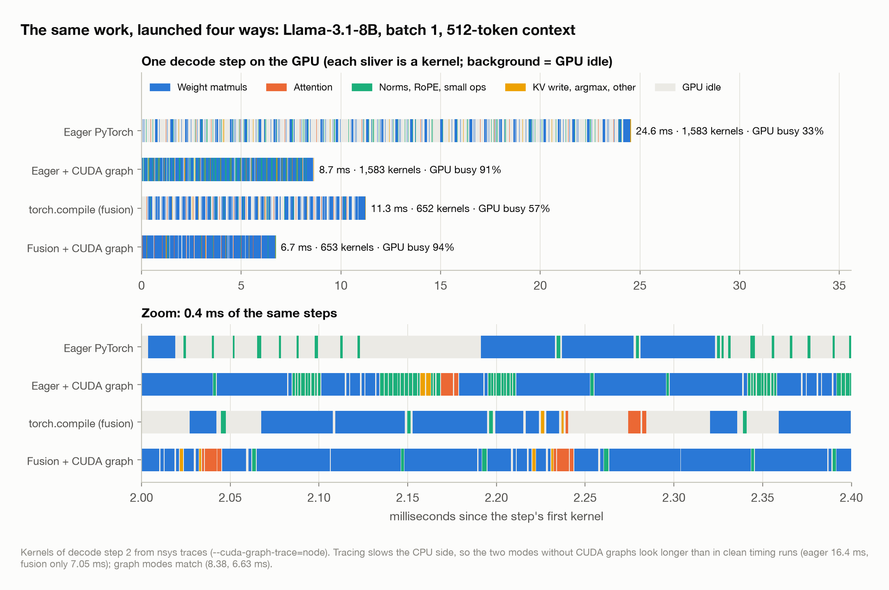

# Where does decode time go?

Profiling LLM decode token by token: Llama-3.1-8B (BF16) on one H100 SXM, then the same code on one B200. What one
generated token *should* cost from first principles (bytes ÷ bandwidth), what it actually costs, and where every
millisecond of the gap goes: CPU launch gaps, CUDA graphs and fusion, weight and KV-cache reads, batching,
quantization, the fixed cost of every kernel, and a vLLM reference.

- **Post 1, H100:** [Where does decode time go? (Medium)](https://medium.com/@ayushgarg70/where-does-decode-time-go-profiling-llama-3-1-8b-on-an-h100-token-by-token-c3afbe77a459) · Full write-up: [`notes/REPORT.md`](notes/REPORT.md) · Every number with its run ID: [`notes/RESULTS.md`](notes/RESULTS.md)
- **Post 2, B200:** Twice the bandwidth, not twice the speed · Full write-up: [`notes/REPORT_B200.md`](notes/REPORT_B200.md) · Every number with its run ID: [`notes/RESULTS_B200.md`](notes/RESULTS_B200.md)



## Headline results (batch 1, one H100 SXM)

| | ms / token | tokens / s | % of bandwidth floor |
|---|---|---|---|
| Floor: 15.0 GB of weights ÷ 3.15 TB/s (measured) | 4.76 | 210 | 100% |
| Hugging Face `generate()` | 18.47 | 54 | 26% |
| This repo, eager PyTorch | 16.39 | 61 | 29% |
| This repo, torch.compile + CUDA graphs | **6.63** | **151** | **72%** |
| vLLM 0.34 (CUDA graphs), 2k context | 6.37 | 157 | 76% |
| This repo, INT4 weights (2k context; perplexity 6.31 → 7.07) | 3.41 | 294 | 40% of INT4's own floor |

Context costs **41.1 ns per token** (the KV cache streams at 3.19 TB/s); batching reaches **6,530 tokens/s**
at batch 128 (2k context). See the report for the sweeps, the Nsight Compute findings and what didn't work.

## Headline results on the B200 (post 2)

| | H100 | B200 |
|---|---|---|
| Measured memory bandwidth (roof) | 3.15 TB/s | 6.63 TB/s (2.10×) |
| Floor at batch 1 (15.0 GB of weights ÷ roof) | 4.76 ms | 2.27 ms |
| This repo, torch.compile + CUDA graphs, batch 1 | 6.63 ms (72% of floor) | **3.86 ms (59%)**: 1.72× faster, not 2.10× |
| vLLM 0.34 (CUDA graphs), batch 1, 2k context | 6.37 ms (76%) | 3.80 ms (61%) |
| Batch 128, 2k context | 6,530 tokens/s | **12,989 tokens/s (76%)**: 1.99× |

Why batch 1 falls short: every kernel pays a fixed cost of a few µs that doesn't shrink with bandwidth (a batch-1
matmul that reads almost nothing still takes 3.7 µs on the B200), and a decode step is 557 kernels. FP8 and NVFP4
didn't speed up batch-1 decode with this stack (0.97× and 1.08×): their matmuls launch too few thread blocks to
keep the memory busy.

## Repository layout

| Path | What |
|---|---|
| `decode/` | The decode loop: a ~300-line Llama in plain PyTorch with a static KV cache (`model.py`, `generate.py`), weight loading, the CLI (`run.py`), quantization (`quant.py`), Hugging Face and vLLM baselines |
| `bench/` | Timing with CUDA events, environment capture, GPU telemetry, E0 ceilings, the fixed-cost sweep (`fixed_cost.py`), the results CSV writer |
| `analysis/` | First-principles predictions (`predict.py`), nsys kernel grouping, ncu summaries, SASS instruction mix, perplexity, charts (`plots.py`; post 2: `plots_blackwell.py`), `RESULTS.md` / `RESULTS_B200.md` generator |
| `profiling/` | nsys and ncu wrappers |
| `runs/` | Run lists per GPU session (H100: `s1.sh` E0–E2, `s2.sh` E3–E5, `s3.sh` E6–E7; B200: `b1.sh` B0–B4, `b2.sh` follow-ups and vLLM) and an unattended chain runner |
| `data/` | Script-written results: `results.csv` (timing runs, append-only), `kernels.csv` (nsys breakdowns), `ppl.csv`, `ceilings.json`, `excluded_runs.csv` (with reasons), `ncu/` (per-kernel Nsight Compute summaries), `steps/` (every kernel of one traced decode step, extracted from the nsys traces, which are too large for git) |
| `figures/` | Charts generated from `data/` (`analysis/plots.py`; post 2 in `b200/`); `illustrations/` holds concept art (no data), with text labels added by `analysis/label_illustrations.py` in `illustrations/labeled/` |
| `notes/` | `REPORT.md` and `REPORT_B200.md` (the long write-ups), `LOG.md` (raw lab notebook), `RESULTS.md` and `RESULTS_B200.md` (generated) |
| `tests/` | CPU tests: predictions vs hand math, parity with Hugging Face on tiny configs, quantization plumbing |

## Reproduce

Locally (any machine, no GPU): `uv sync && uv run pytest` (CPU only: tiny models, the prediction math, the data files).

On a 1×H100 VM with Nsight Systems/Compute installed and access to `meta-llama/Llama-3.1-8B`:

```bash
scripts/push.sh <ssh-host>                     # from your machine: copy the code over
scripts/bootstrap_gpu.sh env                   # on the VM: Python env with CUDA PyTorch
hf auth login && scripts/bootstrap_gpu.sh model
scripts/bootstrap_gpu.sh vllm                  # only for E7 (separate venv)
scripts/check_gpu.sh                           # go / no-go (incl. ncu counter access)
runs/s1.sh e0 ; runs/s1.sh e1 ; ...            # or: SESSION=s2 runs/chain.sh e3 e4 e5
scripts/sync_back.sh <ssh-host>                # from your machine: results, traces, reports
uv run python -m analysis.extract_steps        # only if you have new nsys traces: refresh data/steps/
uv run python -m analysis.plots                # regenerate every chart
uv run python -m analysis.results_table        # regenerate notes/RESULTS.md
```

One step without anything else: `uv run python -m decode.run --mode compiled_graph --batch 1 --context 2048 --fill synthetic`.

Post 2 (1×B200): the same setup, then the run lists `runs/b1.sh` (B0 ceilings, B1 launch modes, B2 batching, B3 low
precision, B4 context, plus nsys/ncu blocks) and `runs/b2.sh` (fixed-cost sweep, more context lengths, repeats, ncu with
unlocked clocks, vLLM as B5; install vLLM with `VLLM_VERSION=0.34.0 scripts/bootstrap_gpu.sh vllm`). Each file lists its
blocks at the top, e.g. `runs/b1.sh b0` or `SESSION=b2 runs/chain.sh fixed b4-more`. Charts and numbers:
`uv run python -m analysis.plots_blackwell` and `uv run python -m analysis.results_table --gpu B200 --out notes/RESULTS_B200.md`.

## Credits

gpt-fast (static KV cache + torch.compile recipe), torchao, vLLM, Hugging Face transformers, NVIDIA Nsight
documentation. The code, experiment runs and analysis were done together with Claude Code (Anthropic). Concept
illustrations generated with OpenAI Codex; every chart is generated from the measured data.

## License

MIT (see [`LICENSE`](LICENSE)).
