# Report: where does decode time go?

The full story of the project, in plain language: what we tested, what we expected, what we measured, what failed, and what we learned. It's written to be read top to bottom, to explain every result in the blog post.

- **This report** explains things. It is longer than the post and includes the dead ends. Code links open at the exact lines on GitHub; `scripts/update_report_links.py` keeps the line numbers current.
- **`notes/LOG.md`** is the raw lab notebook (dates, exact commands, run IDs).
- **`data/results.csv`** holds every measured number. Nothing in here is typed in by hand without a run behind it.

Status markers: ✅ done · 🔄 in progress · ⏳ not started

---

## 1. The question ✅

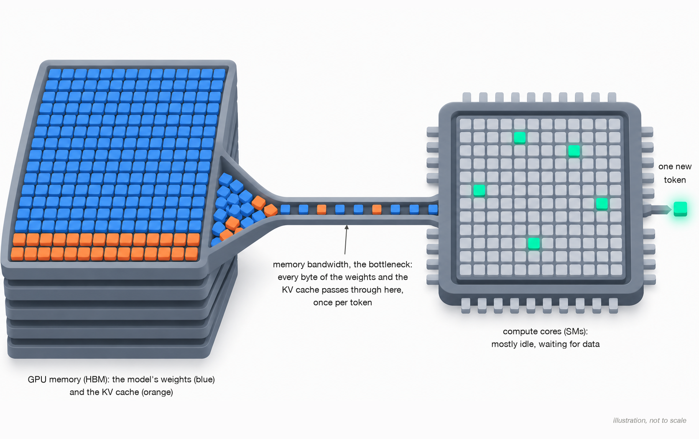

*One decode step as a picture. To produce one token, the GPU has to stream every weight of the model (blue) and the KV cache (orange) out of its memory (HBM) and through the memory bus to its compute cores. The bus is the narrow part: the cores could do far more math than the arriving bytes give them, so most of them sit idle. That's why the time for a token is roughly bytes ÷ bandwidth.*

When a large language model generates text, it produces one token at a time. Each token costs one **decode step**: one pass through the whole model. The question is simple: **how long should one decode step of an 8-billion-parameter model take on one H100 GPU, how long does it actually take, and where does the difference go?**

Setup: **Llama-3.1-8B** (base model) in **BF16** (2 bytes per number) on **one NVIDIA H100 80GB SXM** (preemptible VM on Nebius, eu-north1; driver 580.173.02, PyTorch 2.15 built for CUDA 13.2, transformers 5.23).

---

## 2. What a token should cost: the math ✅

All of this was first worked out by hand (the M0 session), then reproduced by [`analysis/predict.py`](../analysis/predict.py), whose tests ([`tests/test_predict.py`](../tests/test_predict.py)) check every number below. Code: weights per step [`param_counts`](../analysis/predict.py#L116-L130), KV bytes [`kv_bytes_per_token`](../analysis/predict.py#L137-L139), crossover [`crossover_tokens`](../analysis/predict.py#L142-L144), intensities [`matmul_intensity`](../analysis/predict.py#L156-L158) and [`attention_intensity`](../analysis/predict.py#L161-L163), the floor [`floor_ms`](../analysis/predict.py#L174-L177).

### 2.1 Bytes: what has to be read from memory

**Weights.** To produce one token, every weight in the model is used once, so every weight has to be read from GPU memory (HBM) once.

| Piece | Weights |
|---|---|
| Attention, per layer: q 16.8M + k 4.2M + v 4.2M + o 16.8M | 41.9M |
| MLP, per layer: gate, up, down, each 4096 × 14,336 | 176.2M |
| **One layer** | **218.1M** |
| × 32 layers | 6.98B |
| + output layer `lm_head` (4096 × 128,256) | 0.53B |
| **Read per token** | **7.50B weights × 2 bytes = 15.0 GB** |

Two details matter:
- The **input embedding** (also 0.53B weights) is *not* read in full. It's a lookup: one row per token. Adding it back gives 8.03B, the model's published size, which is a good sanity check.
- The **MLP is about 80% of every layer.** So in the profiler, the MLP matmuls should dominate.

*What went wrong on the way:* the first hand count came to 2.68 GB because it missed the output projection `o_proj`, the three MLP matrices and `lm_head`. The check that caught it: the parameters only added up to ~1.9B, not 8B. **Lesson: always check that a count adds up to the model's known size.**

**KV cache.** For every past token, the model keeps its keys (K) and values (V) in every layer, so it doesn't recompute them. Per token: 2 (K and V) × 32 layers × 8 KV heads × 128 numbers × 2 bytes = **131,072 bytes = 128 KiB**. One request's cache is 512 MiB at 4k context, 4 GiB at 32k, and **16 GiB at 128k, about the size of the whole model.**

**Bytes per decode step** = 15.0 GB of weights + B × s × 128 KiB of KV cache, where B is the batch size (requests processed together) and s is the context length (tokens already in each request's cache). The two parts are equal when **B × s ≈ 114,000 tokens**: one request at ~114k context, or 32 requests at ~3.6k each.

### 2.2 FLOPs: how much arithmetic

A FLOP is one multiply or one add. Each weight does one multiply and one add per token, so the matmuls cost **2 × 7.5B ≈ 15 GFLOPs per token**. (The handoff said 16 because it counted the embedding lookup, which isn't a matmul.) Attention adds 4 × layers × heads × head size × s ≈ **0.52 MFLOPs × s**, which is 2.15 GFLOPs at 4k context.

### 2.3 Memory-bound or compute-bound?

**Arithmetic intensity** = FLOPs ÷ bytes read. **The ridge point** is the intensity at which fetching the bytes and doing the FLOPs take equally long. For the H100: 989 TFLOPS ÷ 3.35 TB/s ≈ **295 FLOPs/byte**. Below the ridge, an operation is **memory-bound** (its time is set by bytes ÷ bandwidth); above it, **compute-bound**.

- **Weight matmuls:** each weight is read once and used by all B requests, so the intensity is **B**. At batch 1 that's 1, far below 295.
- **Decode attention:** the intensity is **4** (32 query heads ÷ 8 KV heads), and it doesn't change with B or s, because every request has its own KV cache and nothing is shared. **Decode attention is memory-bound at any batch size.**

### 2.4 The prediction

At batch 1: memory time = 15.0 GB ÷ 3.35 TB/s ≈ **4.48 ms per token (223 tokens/s)**, while compute time = 15 GFLOPs ÷ 989 TFLOPS ≈ **0.015 ms**, about 300× smaller and overlapped with the loading. So **4.5 ms is the floor.** Real decode will be slower, because kernels don't reach full bandwidth, the GPU idles between kernel launches, and there are extra reads (the KV cache, small kernels).

These numbers use the datasheet bandwidth. **E0 measures the real one**, and every prediction gets redone with it.

---

## 3. Building the decode loop ✅ (tested on CPU; GPU test pending)

### 3.1 Why our own loop, not just Hugging Face

Hugging Face's `generate()` is the "typical user" baseline (E1). But its KV cache grows every step (new memory, new shapes), and CUDA graphs need fixed shapes and fixed memory addresses. So we wrote a minimal Llama in plain PyTorch ([`decode/model.py`](../decode/model.py)), in the style of PyTorch's gpt-fast project, with:

- **A static KV cache:** allocated once, at the full size ([`Transformer.setup_caches`](../decode/model.py#L194-L208)), and written in place ([`KVCache.update`](../decode/model.py#L111-L123)). A decode step never allocates memory or changes a shape.
- **Hugging Face's parameter names**, so the real weights load with no conversion ([`load_model`](../decode/load.py#L27-L45)).
- **Hugging Face's own RoPE code.** Llama-3.1 uses a special "llama3" scaling of its position encoding (RoPE), which changes the rotation at every position. Getting it wrong would make our tokens differ from HF's even on short prompts, so we reuse HF's implementation instead of rewriting it ([`rope_inv_freq`](../decode/model.py#L62-L76)).

### 3.2 Three choices that matter for the measurements

1. **No K/V copies for grouped-query attention.** gpt-fast copies the 8 KV heads up to 32 before attention. That writes and re-reads 4× the KV bytes every step and would distort the attention measurements. We use PyTorch's `enable_gqa=True`, which reads the 8 heads directly ([`Attention.forward`](../decode/model.py#L136-L146)).
2. **No giant mask table.** gpt-fast stores a [max_seq × max_seq] causal mask. At 128k context that's 16 GiB of booleans. We compute the mask from positions on the fly ([`Transformer.forward`](../decode/model.py#L210-L230)).
3. **A known side effect:** attention over a static cache reads the *whole* cache buffer every step (the mask hides the unused part, but it's still read). So each run sizes the cache to the context it measures.

### 3.3 The rules CUDA graphs impose

A CUDA graph records a sequence of kernels *with their memory addresses* and replays it with one launch. So the decode loop ([`decode_n_tokens`](../decode/generate.py#L36-L56), with each step done by [`decode_one_token`](../decode/generate.py#L24-L33)) must:
- write the KV cache **in place** (same buffer, same address);
- keep the position counter `input_pos` as **one tensor**, advanced in place, not replaced each step;
- never sync with the CPU inside the loop (no `.item()`, no printing tensors);
- **copy each output token** right away, because the next replay overwrites the output buffer.

The four timing modes, including the manual CUDA-graph capture of the eager step, are set up in [`make_step_fn`](../decode/run.py#L77-L105).

### 3.4 How we know it's correct

[`tests/test_parity.py`](../tests/test_parity.py) compares our model with Hugging Face's on tiny random models (Llama with llama3 RoPE and GQA, and Qwen2 with its q/k/v biases) at batch 1 and 3: logits match ([`test_prefill_logits_match_hf`](../tests/test_parity.py#L83-L87)), and 20 greedy tokens are identical ([`test_greedy_tokens_match_hf`](../tests/test_parity.py#L90-L99)). The CUDA-graph rules are checked with a step function that imitates a graph replay ([`test_decode_loop_is_graph_friendly`](../tests/test_parity.py#L102-L124)), and [`test_compiled_step_matches_eager`](../tests/test_parity.py#L127-L136) checks that `torch.compile(fullgraph=True)` compiles our step with no graph breaks and gives the same tokens.

*What went wrong on the way:* to make sure the tests catch real mistakes, we deliberately planted three classic bugs (not writing the cache in place, replacing `input_pos`, not copying tokens). Two were caught; **one slipped through**. The test compared memory addresses, and the CPU memory allocator happened to give the freed address back to the new, wrong tensor, so the addresses matched by accident. Fixed by checking object identity instead ([`test_kv_cache_update`](../tests/test_parity.py#L66-L80)). **Lesson: test your tests by breaking the code on purpose.**

The real 8B check (our loop vs HF on the GPU, [`decode/parity_8b.py`](../decode/parity_8b.py)) runs at the start of session S1.

---

## 4. Experiments

Each experiment section follows the same template: **What we test and why · Prediction · Result · What failed / surprises · What we learned.**

**Two kinds of run.** A **timing run** runs the decode loop with no profiler attached and puts a CUDA event (a timestamp the GPU records itself, at almost no cost) before and after each step: 20 warm-up steps, then 256 timed steps, median reported, one row in `data/results.csv`. Each configuration also gets a throwaway warm-up process first (see the steady-state rule in `notes/LOG.md`). A **trace** (nsys) or **profile** (ncu) is a separate run of the same configuration that records what happens inside the step: every kernel, its duration, the gaps between them. Profilers slow the run they watch, so step times always come from timing runs, and traces are used for what's inside the step.

### E0: the GPU's real ceilings ✅

**What we test and why.** The datasheet numbers (3.35 TB/s, 989 TFLOPS) are upper limits under ideal conditions. Every later "% of the floor" needs the roof *this* GPU actually reaches, so we measure it with the simplest possible kernels ([`bench/ceilings.py`](../bench/ceilings.py)):
- **Read bandwidth:** reduce a 4 GiB BF16 tensor, in two ways: one big sum, and a sum over 8,192 independent rows. Every byte is read once, and 4 GiB is about 80× the H100's **50 MiB L2 cache** (52,428,800 bytes, as Nsight Compute reports the device), so this measures HBM, not cache.
- **Copy bandwidth:** copy the tensor (bytes counted twice: one read, one write).
- **The roof** is the best of these simple streaming kernels.
- **Matmul throughput:** an 8192 × 8192 × 8192 BF16 matmul (2·M·N·K FLOPs).

**Result** (GPU at full clocks, 1980 MHz SM / 2619 MHz memory; repeats within 0.3%):

| | Measured | Datasheet | % |
|---|---|---|---|
| Read, one big sum | 3.08 TB/s | 3.35 TB/s | 92% |
| Read, sum over rows | **3.15 TB/s** (the roof) | 3.35 TB/s | 94% |
| Copy | 3.05 TB/s | 3.35 TB/s | 91% |
| BF16 matmul | **797 TFLOPS** | 989 TFLOPS | 81% |
| Ridge point | **253 FLOPs/byte** | 295 | |

**What it changes.** The batch-1 floor becomes 15.01 GB ÷ 3.154 TB/s = **4.76 ms per token (210 tokens/s)**, not 4.48 ms. That's the number every later measurement is compared against.

**A correction (what failed).** The first version of this measurement used only the one big sum (3.08 TB/s), and every "% of the floor" was first computed against that. Two things showed it was too low. The context sweep (E4) streamed the KV cache at 3.19 TB/s, faster than the supposed roof. And a different reduction of the same tensor, a sum over rows, reached 3.15 TB/s. A single kernel tells you how fast *that kernel* is, not how fast the memory is, so the roof is now the best of several simple kernels, and every percentage in this report uses it. The differences are small (about 2 points on every "% of the floor"), but a roof that real code beats is not a roof.

**What we learned.** Even a trivially simple read reaches only ~92% of the advertised bandwidth, and a large, ideal matmul only ~80% of the advertised FLOPs. The datasheet is a ceiling nobody hits; you measure your own.
### E1: the eager baseline ✅

**What we test and why.** How fast is decode when you run the model the "normal" way, in eager PyTorch? Three versions, all at batch 1 with a 512-token prompt, timing 256 decode steps after 20 warm-up steps ([`decode/hf_baseline.py`](../decode/hf_baseline.py), [`decode/run.py`](../decode/run.py)):
- Hugging Face `generate()`, the way most people call it;
- a manual loop over the Hugging Face model with its growing ("dynamic") KV cache;
- our own loop with the static cache.

First, a correctness check on the real model ([`decode/parity_8b.py`](../decode/parity_8b.py)): our loop and Hugging Face produce **the same 64 tokens**, and the largest logit difference is 0.16 (ordinary BF16 rounding).

**Prediction.** From E0 the floor is 4.78 ms per token (at this 512-token context). The handoff predicted that eager mode would be far from it, because the CPU has to launch hundreds of small kernels per token.

**Result.**

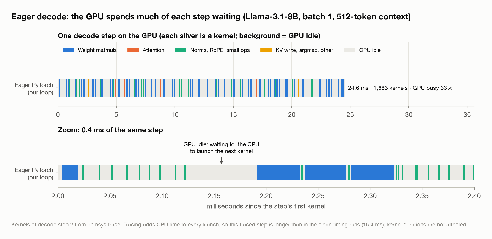

*A real eager decode step on the GPU, from an nsys trace. Each colored sliver is one kernel (blue: weight matmuls, orange: attention, green: norms, RoPE and other small operations, yellow: KV-cache writes and argmax); the light grey background is time the GPU did nothing. Top: the whole step, 1,583 kernels. Bottom: 0.4 ms of the same step, where you can see the problem: each green kernel runs for a microsecond or two, and then the GPU waits for the CPU to launch the next one. (The profiler slows the CPU, so this traced step takes 24.6 ms with the GPU busy a third of the time; in the clean timing runs it takes 16.4 ms and the GPU is idle about half of it.)*

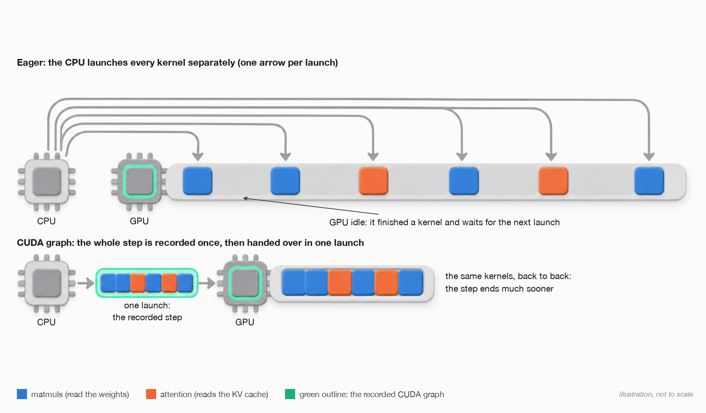

*Why the GPU waits. Top: in eager mode the CPU launches every kernel separately, and launching one takes longer than many kernels take to run, so the GPU sits idle in between. Bottom: the fix measured later (E3), a CUDA graph: the step is recorded once and then launched as a single unit, so the same kernels run back to back. A real step has 1,583 kernels, not six.*

| Implementation | ms per token | tokens/s | % of the 4.78 ms floor |
|---|---|---|---|
| HF `generate()` | 18.3–18.6 | 54–55 | 26% |
| HF manual loop | 17.7–17.8 | 56 | 27% |
| Our eager loop | 16.3–16.4 | 61 | 29% |

All three run at **less than a third of the speed the memory allows**. A second measurement three hours later (after S2) gave 16.7, 15.9 and 14.5 ms for the three versions: about 10% faster across the board, with the same differences between them. Eager decode is limited by the CPU, so it moves with the state of the host machine; the GPU-bound modes (E3–E5) repeat to within 0.01%. `generate()` adds about 0.7–0.8 ms per token on top of the plain loop: its per-step bookkeeping (checking whether every sequence has finished, running the logits processors, growing the attention mask). Our loop is another ~1.4 ms faster, but **not because of its static cache**. The nsys traces show the HF loop runs *fewer* kernels than ours (1,494 vs 1,583 per step) and its kernels take about the same GPU time (7.87 vs 8.06 ms). The whole difference is idle time (step time minus kernel time: 9.78 vs 8.34 ms): Hugging Face's Python code (mask building, cache-object methods, more layers of modules) spends more CPU time between launches. The static cache matters later, in E3: it's what makes CUDA graphs possible.

**What failed / surprises: the profiler changes what it measures.** Inside the nsys trace, an eager step takes 23–29 ms instead of 16.4 ms. The profiler records every kernel launch, which costs the CPU ~5–7 µs extra per launch, and there are ~1,600 launches per step. The GPU kernels themselves don't get slower. So we take **kernel times from the trace** and **step times from the clean timing runs**. And the fact that adding CPU time slowed the step one-for-one is itself proof that the step is waiting on the CPU (see E2).
### E2: anatomy of one decode step ✅

**What we test and why.** Where do the 16.4 ms of an eager step go? We sort every kernel in the nsys trace into groups by its name ([`analysis/group_kernels.py`](../analysis/group_kernels.py)) and add up their GPU time per step. Whatever is left of the step is time the GPU sat **idle**, waiting for the CPU to launch the next kernel.

**Result** (our eager loop, batch 1, 512 context):

| Part of the step | ms per step | kernel launches | share of the step |
|---|---|---|---|
| Weight matmuls | 5.76 | 385 | 35% |
| Norms, RoPE, other small ops | 1.78 | 1,068 | 11% |
| Attention | 0.30 | 64 | 2% |
| Writing the KV cache | 0.17 | 64 | 1% |
| Picking the token (argmax) | 0.04 | 1 | 0.2% |
| **GPU idle** | **8.34** | | **51%** |
| **Whole step** | **16.39** | **1,583** | |

What it shows:
- **The GPU is idle half the time.** 1,583 kernel launches per token, about 10 µs of step time each. Python and PyTorch need roughly that long to prepare and launch each operation, while most of the small kernels finish in 1–3 µs. The GPU finishes faster than the CPU can feed it. This is what "overhead-bound" means.
- **The matmuls themselves are good.** They read the 15.0 GB of weights in 5.76 ms, which is **2.60 TB/s, 83% of the measured bandwidth**. The biggest one, `lm_head` (1.05 GB), takes 350 µs, about 3.0 TB/s. The small k and v projections (8.4 MB each) only reach about half the bandwidth: too small to keep the whole GPU busy.
- **Over a thousand tiny kernels** (norms, rotary embeddings, additions, type conversions) take only 1.8 ms of GPU time but cost about 1,000 launches.
- Small surprises: cuBLAS splits 160 of the 225 matmuls into pieces ("split-K"), and each needs an extra kernel to add the pieces up; the argmax over 128k vocabulary entries is one slow 37 µs kernel; the attention mask gets converted in every layer: our boolean mask is turned into the additive BF16 mask (0 = keep, −inf = hide) that the cuDNN kernel takes, inside every attention call, so the identical conversion runs 32 times per step (2 fills + 1 `where` per layer = 96 kernels, 0.17 ms of GPU time, but 96 launches in eager mode). torch.compile fuses it into one kernel per layer.

Hugging Face's loop looks the same: 1,494 launches, 55% idle.

**Inside the kernels: Nsight Compute (ncu).** nsys says *how long* each kernel ran; ncu says *why*, by reading the GPU's hardware counters while replaying a kernel ([`analysis/ncu_summary.py`](../analysis/ncu_summary.py)). ncu runs kernels at a locked base clock, so we use its percentages and byte counts, not its durations.

| Kernel (batch 1) | Bytes read | DRAM bandwidth (% of 3.35 TB/s spec) | Tensor cores busy | Blocks (GPU has 132 SMs) |
|---|---|---|---|---|
| `lm_head` matmul (1.05 GB of weights) | 1.05 GB | **87%** (~92% of our measured roof) | **3%** | 132 |
| MLP matmuls (117 MB each) | 117 MB | 81–82% | 3% | 128–132 |
| q, o projections (34 MB) | 34 MB | 64–65% | 2% | 128 |
| k, v projections (8.4 MB) | 8.4 MB | **31–32%** | 1% | **48** |
| Attention (cuDNN, 512 context) | | 9.5% | 1% | **32** |
| Norms, RoPE, adds (1,068 kernels) | tiny | 0.2% | 0% | |

What it shows:
- **The big matmuls run at the memory roof while the tensor cores idle.** `lm_head` pulls 87% of the spec bandwidth (about 92% of what E0 measured), while the tensor cores, the H100's math engines, are busy 3% of the time. This is "memory-bound" in one line of counters: the bytes can't arrive fast enough to give the math units work.
- **Small matmuls can't fill the GPU.** The k and v projections (8.4 MB each) launch only 48 blocks of work for 132 SMs, and reach about a third of the bandwidth.
- **Hopper features are used where cuBLAS is used.** The matmuls are Hopper-specific cuBLAS kernels (`nvjet_sm90_…`). They issue Hopper's WGMMA tensor-core instructions, and **all of their 1.07 GB of loads arrive through TMA**, the Tensor Memory Accelerator, Hopper's hardware unit that copies whole tiles from memory without threads issuing loads.
- **Attention doesn't use them.** PyTorch dispatches decode attention to a cuDNN kernel built for the *previous* generation (`…sdpa_sm80…`, Ampere): **zero WGMMA instructions**, only the older MMA, and just **32 blocks** (one per head) for 132 SMs. At 512 tokens of context that hardly matters; at long context it might (E4).
- **The argmax runs as a single block**: one SM does all the work of picking the next token from 128k scores, hence 37 µs.

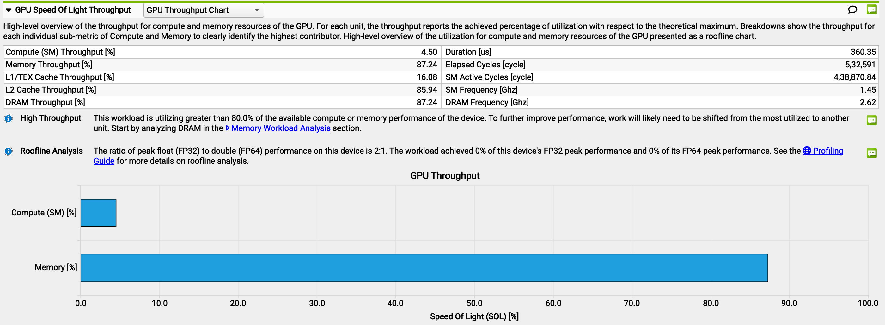

*Nsight Compute's "Speed of Light" section for the `lm_head` matmul. Each row is how busy one part of the GPU was, as a percentage of its peak: memory (DRAM) at 87%, the SMs' compute at 4.5%; the bars at the bottom show the same two numbers. A kernel near the memory peak and far from the compute peak is memory-bound: it waits for bytes, not for math. (ncu runs the kernel at a locked base clock, so we don't use its 360 µs duration.)*

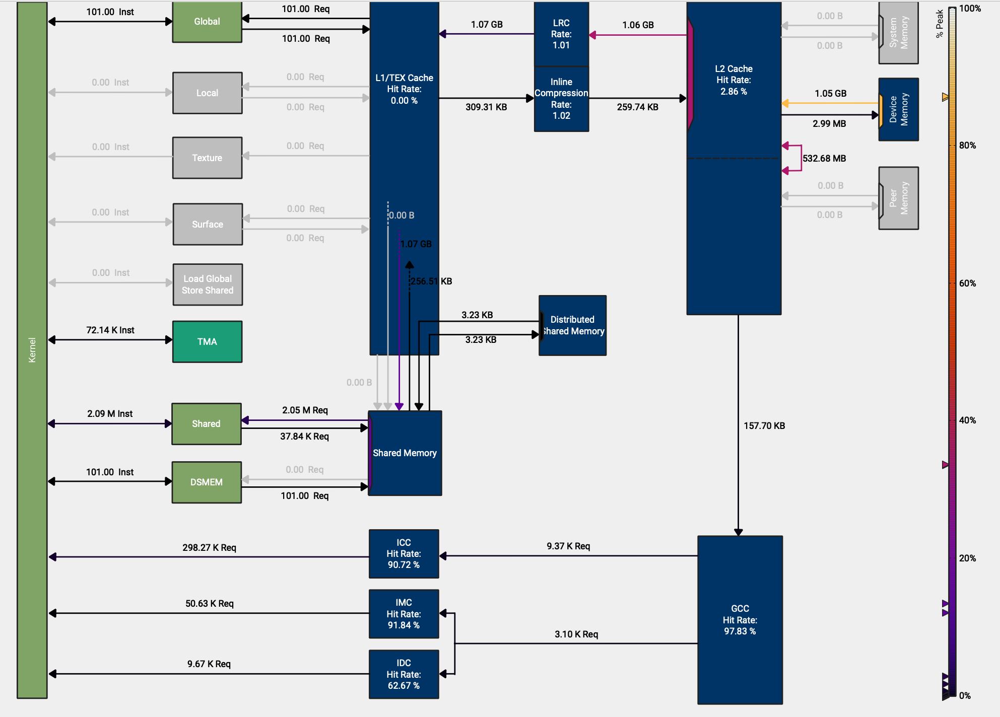

*Nsight Compute's memory chart for the same kernel: where its bytes travel. Read it from right to left: 1.05 GB come out of device memory (DRAM, the "Device Memory" box on the right), pass through the L2 cache (hit rate 2.9%: each weight is read once per step, and the 15 GB of weights are 300× the 50 MiB L2, so nothing is still cached when the next step comes around), and reach the SMs. On the left, the kernel issues only 101 ordinary global-load instructions but 72 thousand TMA instructions: the TMA copy engine moves whole tiles of weights, so the threads never load them one by one.*

**Which hardware each kernel actually uses (assembly instruction counts, [`analysis/sass_mix.py`](../analysis/sass_mix.py)).** ncu can also list every machine instruction a kernel executed. Counting the ones that matter:

| Kernel | Tensor-core instruction | How data is loaded |
|---|---|---|
| cuBLAS matmul (`nvjet_sm90`, e.g. `lm_head`) | **HGMMA** (Hopper's WGMMA): 2.05 million | **UTMALDG** (TMA): 64 thousand, each moving a whole tile; plain loads: 1.3 thousand |
| cuDNN attention (`…sdpa_sm80…`) | **HMMA** (Ampere-style): 1.05 million; **zero HGMMA** | **LDGSTS** (Ampere's async copy): 562 thousand; **zero TMA** |

So the matmuls run on Hopper's newest paths (WGMMA tensor cores fed by the TMA copy engine), while PyTorch's decode attention runs code written for the previous GPU generation. For decode that's fine, since both are limited by memory bandwidth, not by the instructions. For prefill, where attention is compute-heavy, it would matter much more.

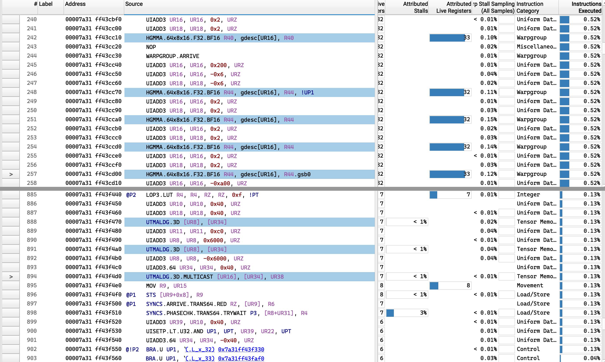

*Two excerpts of the `lm_head` kernel's machine code (SASS) in Nsight Compute's Source view; each row is one instruction, and the highlighted rows are the ones that matter. Top: `HGMMA.64x8x16.F32.BF16` is Hopper's warpgroup tensor-core instruction (WGMMA): each instruction multiplies a 64 × 16 block of weights by a 16 × 8 block of inputs (our one real token, padded to 8, the smallest width the instruction supports), with the running sums kept in FP32. Bottom, from another part of the kernel: each `UTMALDG` asks the TMA to load one tile from memory into shared memory, and the `SYNCS` instructions wait for tiles to arrive. The columns on the right show how often each instruction ran.*

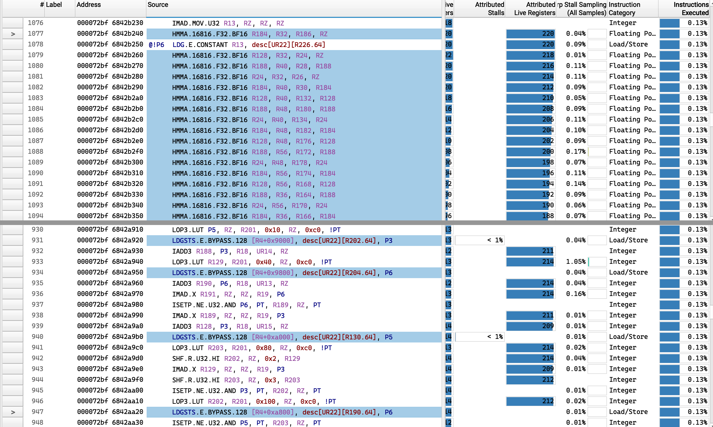

*The same view for cuDNN's attention kernel. Top: `HMMA.16816.F32.BF16`, the older (Ampere) tensor-core instruction, where each warp multiplies its own small 16×8×16 tile. Bottom: `LDGSTS` ("load global, store shared"), Ampere's asynchronous copy, where each thread copies a 16-byte piece of the KV cache into shared memory. This kernel contains no HGMMA and no TMA instructions at all.*

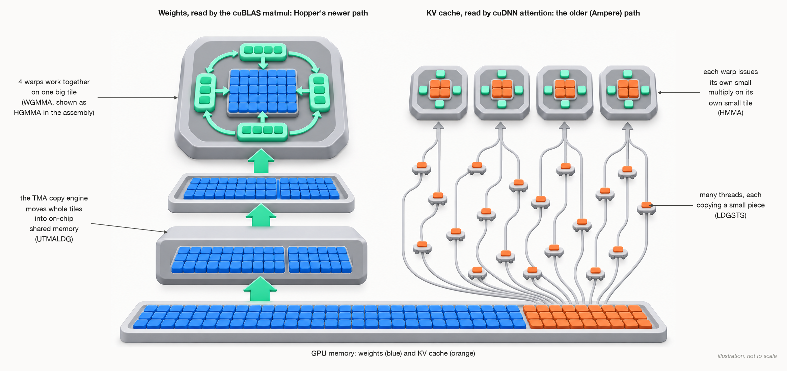

*The two paths side by side. Left: the weights reach the tensor cores through the TMA, which copies whole tiles into on-chip shared memory, and four warps (a warpgroup, one in each quarter of the SM) multiply one big tile together (WGMMA), so all four of the SM's tensor cores work on the same tile. Right: the KV cache is loaded by many threads, each copying a small piece (LDGSTS), and each warp issues its own small multiply (HMMA) on its own small tile. For decode both paths end up waiting on memory, so the older one costs little here.*

*What failed:* capturing every kernel of a whole step took 44 minutes (ncu replays each of the ~1,600 kernels and does a lot of work on the CPU per kernel). One layer plus `lm_head` tells the same story in about a minute.
### E3: CUDA graphs and fusion (the 2×2) ✅

**What we test and why.** E2 showed two separate problems: the GPU idles while the CPU launches kernels, and there are over a thousand tiny kernels. Two fixes exist, and `torch.compile(mode="reduce-overhead")` applies both at once, which hides how much each one helps. So we measure all four combinations ([`make_step_fn`](../decode/run.py#L77-L105)):
- **CUDA graph:** record the whole decode step once, then replay it with a single launch. No per-kernel CPU work, but the same kernels. We capture the plain eager step ourselves with `torch.cuda.CUDAGraph`, which works only because our KV cache is static.
- **Fusion:** `torch.compile` merges chains of small operations into single kernels that it writes itself (in Triton). Fewer kernels, but still launched one by one.

**Result** (batch 1, 512 context; three repeats each, kernel times from nsys, step times from clean timing runs):

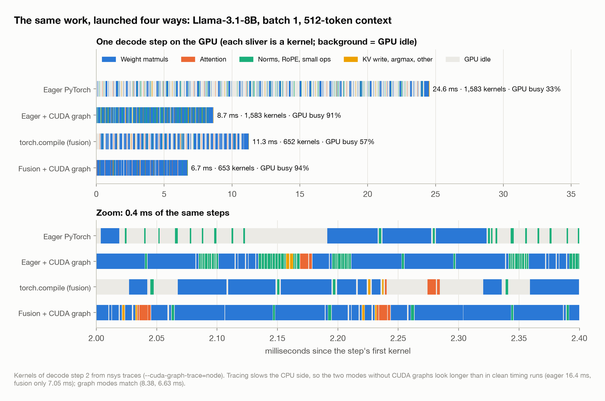

*Real GPU timelines of one decode step for each of the four combinations, from nsys traces (same colors as the eager timeline: each sliver is a kernel, grey background = GPU idle). With a CUDA graph (rows 2 and 4) the grey gaps almost disappear; with fusion (rows 3 and 4) there are far fewer kernels and almost no green ones. The bottom panel zooms in on 0.4 ms. The two rows without a graph are stretched by the profiler (24.6 and 11.3 ms traced, against 16.4 and 7.05 ms in clean runs); the graph rows are not, because the CPU does nothing during a replay.*

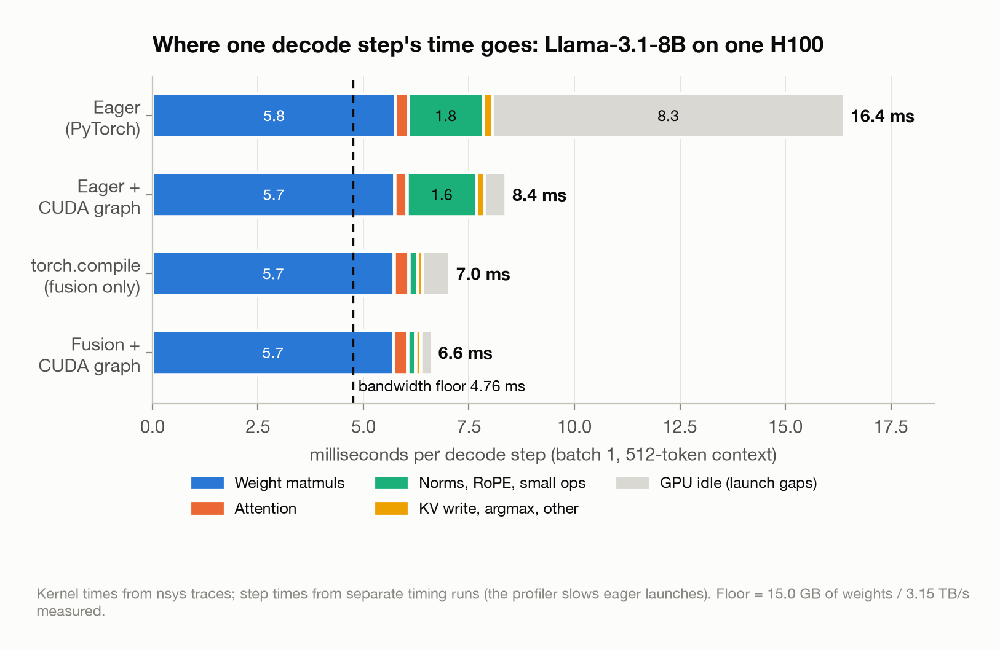

*Where each step's time goes, for the four combinations. Each bar is one clean step, split into kernel time per group (from the traces) and idle time (clean step time minus kernel time). The dashed line is the bandwidth floor. The weight matmuls (blue) take about 5.7 ms in every mode, so the four modes differ only in the small operations (green) and the idle time (grey). With both fixes, the step is almost all matmuls.*

| Mode | Kernel launches | GPU busy | GPU idle | Step | % of floor |
|---|---|---|---|---|---|
| Eager | 1,583 | 8.06 ms | 8.34 ms (51%) | 14.6–16.4 ms | 29–33% |
| Eager + CUDA graph | 1,583 | 7.87 ms | **0.51 ms (6%)** | 8.38 ms | 57% |
| Fusion, no graph | **652** | 6.40 ms | 0.65 ms (9%) | 7.05 ms | 68% |
| **Fusion + CUDA graph** | 653 | 6.36 ms | **0.26 ms (4%)** | **6.63 ms** | **72%** |

What it shows:
- **A CUDA graph alone removes almost all of the idle time**: 8.3 ms of gaps shrink to 0.5 ms, and the step halves. But the GPU still runs 1,583 kernels, and the 1,068 tiny ones still cost 1.6 ms.
- **Fusion alone does even better here**, because it attacks both problems: the 1,068 small kernels become **98**. For example, each RMSNorm (square, mean, add, square root, multiply, type conversions, residual add) becomes one kernel, and RoPE is fused with the KV-cache write. Their time drops from 1.64 ms to 0.21 ms, and with only 652 launches the CPU keeps up most of the time even without a graph: the step is idle for 0.65 ms, of which about 0.26 ms is the GPU's own kernel-to-kernel switching (the same as with a graph), so the CPU still costs about 0.4 ms.
- **Both together: 6.63 ms, 72% of the floor, 151 tokens/s.** The matmuls are now 86% of the step (5.71 ms). The remaining gap to the 4.78 ms floor is mostly the matmuls themselves running at ~83% of the measured bandwidth (E2), plus attention (0.34 ms) and a handful of small kernels.
- **Stability:** the graph modes repeat to within 0.01% (6.6259, 6.6259, 6.6265 ms). Eager varied by 10% between E1 and E3, an hour apart, because a CPU-bound step depends on how the host CPU is doing.
### E4: long context, when KV reads take over ✅

**What we test and why.** Every decode step reads the whole KV cache, so each extra token of context should add a fixed number of bytes (128 KiB) and therefore a fixed amount of time. We sweep the context from 512 tokens to the model's maximum of 131,072, at batch 1 with CUDA graphs and fusion. The cache is filled with synthetic values: decode cost depends on how many bytes are read, not what they contain. A real 8k prefill gives the same step time to within 0.02% (7.017 vs 7.018 ms).

**Prediction.** Time per step = (15.0 GB + s × 128 KiB) ÷ 3.154 TB/s: a straight line rising **41.6 ns per token** of context. KV bytes equal weight bytes at about 114.5k tokens.

**Result.**

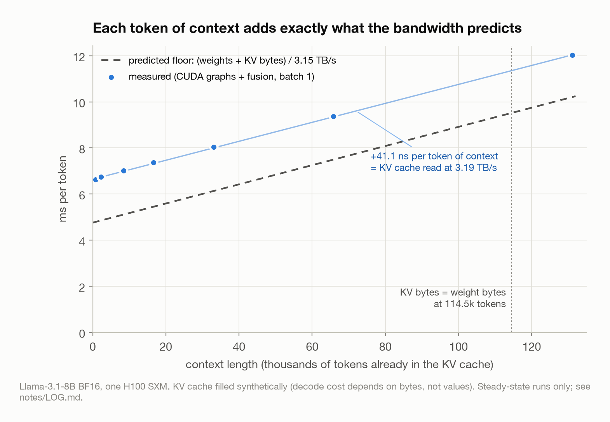

*Time per decode step as the context grows (batch 1, CUDA graphs + fusion). Dots: measurements. Dashed line: the bandwidth floor, (weights + KV-cache bytes) ÷ 3.15 TB/s. The measurements lie on a straight line (light blue) that rises 41.1 ns per token of context, almost exactly the floor's slope: each extra token of context costs the time it takes to read its 128 KiB of KV cache. The dotted vertical line marks where the KV cache becomes as big as the weights (114.5k tokens).*

| Context | ms per token | % of the floor |
|---|---|---|
| 512 | 6.62 | 72% |
| 2k | 6.74 | 72% |
| 8k | 7.02 | 73% |
| 16k | 7.37 | 74% |
| 32k | 8.04 | 76% |
| 64k | 9.38 | 80% |
| ~128k | 12.03 | 85% |

A straight line fits every point to within 0.05 ms: **6.65 ms + 41.1 ns per token of context**, against 41.6 ns predicted, so the KV cache streams at **3.19 TB/s, right at the measured roof** (3.15 TB/s). Looking closely, the line bends very slightly: between 64k and 128k each extra token costs only 40.6 ns, because the attention kernel (below) streams a long cache a little more efficiently than a short one. And because KV bytes are read more efficiently than weight bytes (the weights at ~83%, E2), the step gets *closer* to its floor as context grows: 72% at short context, 85% at 128k. (These KV numbers were the clue that the first roof measurement was too low; see E0.)

**My prediction that failed.** I expected attention at long context to under-use the GPU: at 512 tokens the cuDNN attention kernel launches only 32 blocks (one per head) for 132 SMs. ncu at 64k says otherwise: the same kernel launches **256 blocks**. It splits each head's KV sequence into 8 chunks, processes them in parallel and merges the partial results in a small second kernel (the idea known as *flash-decoding*). It reads exactly the predicted bytes (269.8 MB per layer vs 269.6 MB predicted) at **85% of the spec bandwidth**. It still uses the older Ampere-style tensor-core instructions (no WGMMA, no TMA), but at 4 FLOPs per byte the math units hardly matter: the job is moving bytes, and it does that well.

**What it means.** At 128k context, one request's KV cache (16 GiB) is as big as the whole model, and the step takes 1.8× longer than at short context. Long context makes decode slower in proportion to the bytes, exactly as predicted, and no amount of compute helps: only fewer bytes (an FP8 KV cache, E7) or less context.
### E5: batching, sharing the weights ✅

**What we test and why.** All requests in a batch share one read of the 15 GB of weights, but each brings its own KV cache. So adding requests should be almost free until the KV bytes catch up with the weight bytes. We decode B requests together, each with 2,048 tokens of context, for B from 1 to 128, with CUDA graphs and fusion.

**Prediction.** Time per step = (15.0 GB + B × 2,326 tokens × 128 KiB) ÷ 3.154 TB/s. (2,326 is the cache size actually read: the 2,048-token context plus room for the timed steps.) KV bytes equal weight bytes at B ≈ 49.

**Result.**

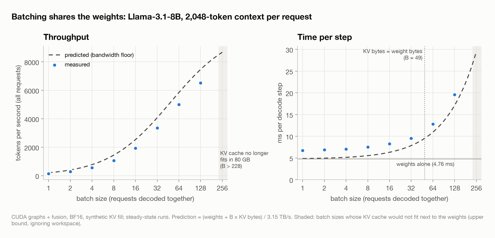

*Batching, with 2,048 tokens of context per request. Left: total tokens per second; right: time per step; dots are measurements, dashed lines the bandwidth floor. Up to about batch 16 the step barely gets slower (right), so throughput grows almost in proportion to the batch (left): all requests share one read of the weights. The dotted vertical line (B = 49) is where the requests' KV caches together become as big as the weights; past it, step time grows with the batch. The shaded area marks batch sizes whose KV cache wouldn't fit in the GPU's 80 GB.*

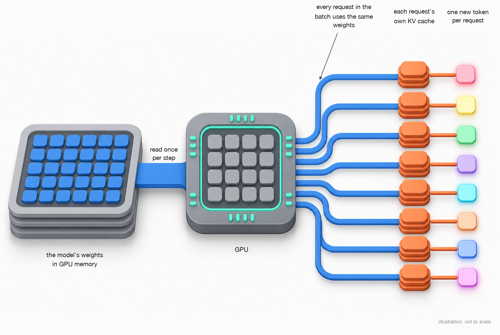

*Why batching is nearly free: the weights (blue) are read once per step and used for every request in the batch, while each request brings its own KV cache (orange), which has to be read separately. Eight requests are drawn; we measured up to 128.*

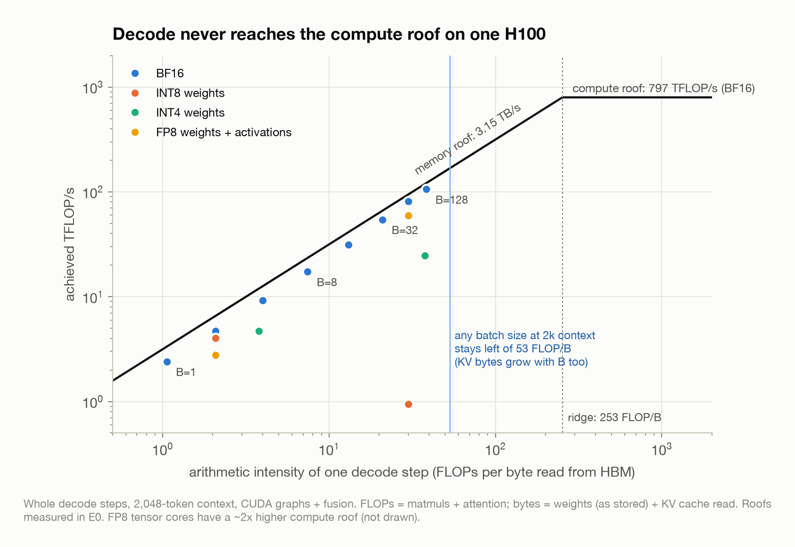

*The roofline. Each dot is a whole decode step (2k context, CUDA graphs + fusion). Horizontal axis: arithmetic intensity, the FLOPs done per byte read from memory; vertical axis: FLOPs per second achieved; both axes are logarithmic. The slanted black line is the memory roof (3.15 TB/s) and the flat one the compute roof (797 TFLOP/s); they meet at the ridge, 253 FLOPs per byte. Blue dots are BF16 from batch 1 to 128, climbing along the memory roof as the batch grows; the other colors are the quantized formats at batch 1 and 32. Every dot is far left of the ridge, and the blue vertical line shows why: because each request's KV cache grows the bytes along with the FLOPs, no batch size at this context can get past 53 FLOPs per byte.*

| Batch | ms per step | tokens/s (all requests) | % of the floor |
|---|---|---|---|
| 1 | 6.74 | 148 | 72% |
| 2 | 6.89 | 290 | 72% |
| 4 | 7.06 | 567 | 72% |
| 8 | 7.50 | 1,067 | 73% |
| 16 | 8.28 | 1,933 | 74% |
| 32 | 9.54 | 3,354 | 78% |
| 64 | 12.81 | 4,996 | 80% |
| 128 | 19.60 | 6,530 | 80% |

- **Batching is almost free at first:** 8 requests cost 11% more time than 1 and give 7.2× the throughput. 128 requests give **44× the tokens per second** for 2.9× the step time.
- **Then the KV cache takes over.** Past B ≈ 49 the step reads more KV-cache bytes than weight bytes, and time grows almost in proportion to B. At B = 128 the step reads 39 GB of KV cache next to 15 GB of weights.
- **Memory caps the batch before compute matters.** The KV cache of more than about 228 requests at this context would not fit in 80 GB next to the weights. And the weight matmuls only reach the ridge point (compute-bound) around B ≈ 253. So with BF16 weights and 2k context on one H100, **decode never becomes compute-bound**.

**Inside the matmuls (ncu, layer 5):**

| Batch | cuBLAS tile | MLP matmul | DRAM (% of spec) | Tensor cores busy |
|---|---|---|---|---|
| 1 | 64 × 8 | 44 µs | 81% | 2.8% |
| 8 | 64 × 8 (same kernel) | 44 µs | 81% | 2.8% |
| 64 | 112 × 64 | 44–45 µs | 80% | 22% |

cuBLAS's smallest tile already covers 8 requests, so at batch 1 seven-eighths of the tensor-core work is multiplying padding: batch 8 runs *the same kernel in the same time*. At batch 64 the tensor cores are 8× busier, and the matmul still takes the same 44 µs, because it's still waiting on memory.

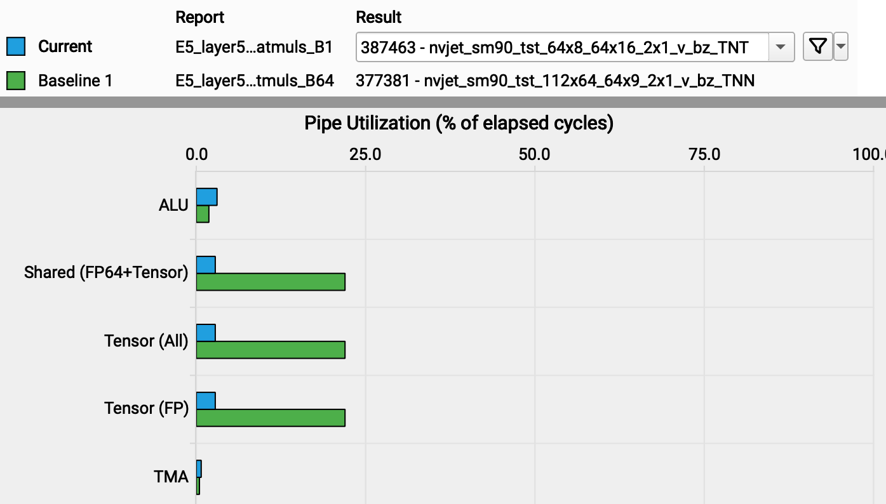

*Nsight Compute comparing the same MLP matmul at batch 1 (blue, "Current") and batch 64 (green, "Baseline 1"). The kernel names at the top show cuBLAS picked a bigger tile for batch 64 (112×64 instead of 64×8). Each bar is a pipe's utilization, the share of cycles that kind of execution unit was busy: the tensor pipes go from about 3% to about 22%. The kernel takes the same 44 µs at both batch sizes, because it's waiting on memory either way.*

**What failed / surprises.** The same "fast first run" oddity as in E4 showed up for batch 2–16 (one run 0.28 ms faster). Five back-to-back runs at batch 2 all gave 6.887 ms, so the slower value is the steady state, and the fast runs are excluded (with reasons, in `data/excluded_runs.csv`). The root cause is still open: the fast runs have smaller gaps between kernels *inside* the CUDA graph (0.15 µs vs 0.6 µs), with identical kernels.

### E6: quantization (INT8, INT4, FP8) ✅

**What we test and why.** If decode is limited by the bytes of weights it reads, storing weights in fewer bits should make it faster in proportion. We quantize every linear layer (including `lm_head`) with torchao 0.18 ([`decode/quant.py`](../decode/quant.py)) in three ways:
- **INT8 weight-only:** 1 byte per weight plus one scale per output row. The matmul still happens in BF16; the weights are converted on the fly.
- **INT4 weight-only:** half a byte per weight, plus a scale and zero point for every group of 128 weights. It runs on PyTorch's built-in *tinygemm* kernel, the one gpt-fast made popular.
- **FP8 (weights *and* activations):** 1 byte per weight; activations are also converted to FP8 on the fly, so the matmul runs on Hopper's FP8 tensor cores (cuBLAS).

Every speed number comes with a quality number: perplexity on the WikiText-2 test set (289k tokens, [`analysis/ppl.py`](../analysis/ppl.py)). Perplexity measures how surprised the model is by real text: lower is better, and small increases mean small quality losses.

**Prediction.** The floor scales with the bytes actually stored, which we measure from the quantized model rather than assume: **BF16 15.01 GB, INT8 7.51 GB, FP8 7.51 GB, INT4 3.99 GB** (the scales and zero points make INT4 0.53 bytes per weight, not 0.5). So the ideal speed-ups at batch 1 are about 2× for INT8 and FP8 and 3.8× for INT4. They should shrink at batch 32, where the KV cache (not quantized) is a larger share of the bytes.

**Result.**

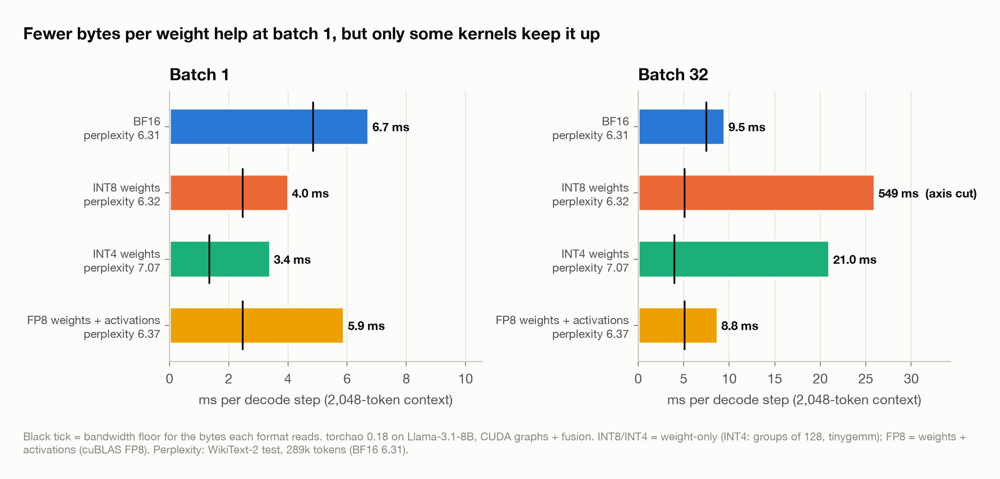

*Decode time per weight format at 2k context; left batch 1, right batch 32. Bars: measured time per step. Black tick: that format's bandwidth floor (the bytes it reads ÷ 3.15 TB/s). The labels on the left give each format's perplexity on WikiText-2 (lower is better). At batch 1 every format beats BF16, but none gets near its own floor: INT4's bar is 2.5× its tick. At batch 32 only FP8 beats BF16; INT8's bar is cut off at the edge (549 ms), because its kernel falls back to a slow path for more than one row.*

| Weights | Perplexity | B=1, 2k | B=32, 2k | B=1, 32k |
|---|---|---|---|---|
| BF16 | 6.31 | 6.74 ms | 9.54 ms | 8.05 ms |
| INT8 | 6.32 (+0.1%) | **4.02 ms** (1.7×) | **549 ms** (58× *slower*) | 5.55–5.83 ms |
| INT4 | 7.07 (**+12%**) | **3.36–3.45 ms** (2.0×) | 21.0 ms (2.2× slower) | 4.74–4.78 ms |
| FP8 | 6.37 (+1.0%) | 5.85–5.96 ms (1.1×) | 8.75 ms (1.09×) | 7.05–7.10 ms |

**Why none of them reaches its ideal, even at batch 1.** nsys shows the weight matmuls read their bytes much less efficiently than BF16 does: bytes ÷ matmul time is **2.6 TB/s for BF16, 2.0 for INT8, 1.56 for INT4 and 1.50 for FP8**. Each format pays for something extra:
- **INT8:** at batch 1, torch.compile fuses "read INT8, convert, multiply" into one Triton kernel per matmul, written as a reduction (a matrix-*vector* product, no tensor cores). It's good, but it isn't cuBLAS.
- **INT4:** tinygemm has to unpack 4-bit values and apply a scale and zero point to every group of 128 before using the tensor cores (old-style HMMA instructions, plain loads, no TMA). That work is no longer hidden behind the memory reads.
- **FP8:** cuBLAS runs on Hopper's real FP8 tensor cores (QGMMA instructions, fed by TMA), but with tiles of 128 output features × 128 input rows. At batch 1 that hurts twice. First, 127 of the 128 input rows are padding, so every block does 128× the useful math. Second, a layer with few outputs splits into few tiles, and each tile is one block: the k and v projections (1,024 outputs) launch **8 blocks**, and q, o and down (4,096 outputs) **32 blocks**, on a GPU with 132 SMs. Those kernels are compute-bound on the few SMs they use: the tensor pipe is busy 73% of those SMs' cycles (ncu), mostly multiplying padding, while the rest of the GPU sits idle. k and v read at 0.33 TB/s, and q, o and down at about 1.45 TB/s. The matmuls with enough blocks (gate and up with 112, `lm_head` with 132) stream at about 2.4 TB/s. The 1.50 TB/s also includes the small Triton kernels that measure and convert each layer's activations to FP8 (0.40 ms per step); the FP8 matmuls alone reach 1.62 TB/s.
- And the parts quantization doesn't touch (attention, norms, the KV cache) stay the same size: about 0.4–0.5 ms per step at 2k context.

**The batch-32 collapse (what failed, and why).** INT8 at batch 32 took 549 ms per step. A sweep showed it's fast *only* at batch 1: 4.0 ms at B=1, then 60, 91, 151, 287 and 549 ms at B=2–32. The B=32 trace explains it: for more than one row, torch.compile doesn't fuse the INT8 matmul and instead calls a generic PyTorch kernel (`weight_int8pack_mm_kernel`) that works in FP32 with no tensor cores, plus conversion kernels before and after every call. That's 540 ms of the 549. INT4's tinygemm is designed for very small batches; its time rises steadily with batch size (3.4 ms at B=1, 6.8 at B=8, 11.0 at B=16, 21.0 at B=32). **Only FP8 stays faster than BF16 at batch 32**, because it runs on cuBLAS's normal Hopper matmul path.

**What it means.** Quantization helps decode exactly as far as two things allow: the kernel has to read the smaller bytes efficiently, and it has to stay efficient at the batch size you actually serve. At batch 1, INT8 is the best deal here (1.7× faster, quality unchanged), and INT4 is the fastest (2.0×) but loses noticeable quality with this simple recipe (+12% perplexity; better INT4 methods like GPTQ or AWQ calibrate on data to reduce that). At batch 32, only FP8 helps. *"Fewer bits" is a promise about bytes; whether you see the speed depends on the kernel.*

### E7: vLLM reference and FP8 KV cache ✅

**What we test and why.** vLLM is a widely used production inference engine. Running the same model on the same GPU tells us how close our ~300-line loop gets to it, and lets us try an **FP8 KV cache** (half the bytes per token of context), which vLLM supports out of the box. We measure it the same way as the Hugging Face baseline: time 257 generated tokens and 1 generated token with the same prompt, and divide the difference by 256 ([`decode/vllm_bench.py`](../decode/vllm_bench.py), vLLM 0.34.0).

**Prediction.** With CUDA graphs, vLLM should sit near our compiled loop, since both are limited by the same bytes. With `--enforce-eager` (no graphs) it should be CPU-bound like our eager loop. An FP8 KV cache should halve the time each token of context adds: about 21 ns per token instead of 42.

**Result.**

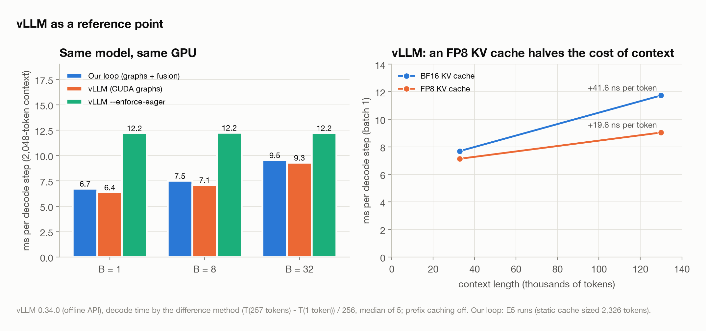

*Left: time per decode step for our loop (blue), vLLM with CUDA graphs (orange) and vLLM in eager mode (green), at batch 1, 8 and 32 with 2k context. vLLM is 2.5–5.5% faster than our loop; without graphs it takes 12.2 ms at every batch size, the sign of a step limited by the CPU. Right: vLLM at batch 1 with a BF16 KV cache (blue) and an FP8 KV cache (orange), measured at 32,768 and 130,000 tokens of context; each line joins the two points. Halving the bytes per cached token halves the cost of each token of context (41.6 → 19.6 ns).*

| | B=1 | B=8 | B=32 |
|---|---|---|---|
| Our loop (graphs + fusion) | 6.74 ms | 7.50 ms | 9.54 ms |
| vLLM (CUDA graphs) | **6.37 ms** (157 tok/s) | 7.10 ms | 9.30 ms |
| vLLM `--enforce-eager` | 12.2 ms | 12.2 ms | 12.2 ms |

- **vLLM is 2.5–5.5% faster than our loop.** We didn't trace vLLM's kernels, so the reason is a guess, not a finding: likely more aggressive kernel fusion and a decode-specific attention kernel. Both implementations sit at 72–80% of the bandwidth floor at 2k context.
- **Without CUDA graphs, vLLM takes 12.2 ms at every batch size.** A flat line across batch sizes is the signature of a CPU-bound loop: the GPU work grows with B, but the step time is set by how fast Python can launch kernels. It's still faster than our eager loop (14.5–16.4 ms) or Hugging Face's (15.9–18.6 ms).
- **Context costs the same in vLLM as in our loop: 41.6 ns per token** of context with a BF16 KV cache (ours: 41.1).
- **An FP8 KV cache halves that to 19.6 ns per token.** At 130k context a step takes 9.04 ms instead of 11.73 (23% faster); at batch 32 with 2k context, 8.18 ms instead of 9.30 (12% faster). We did not measure the quality cost of the FP8 KV cache.

**What it means.** A minimal loop with a static KV cache, CUDA graphs and torch.compile gets within about 5% of a production engine for single-GPU decode. That's the main lesson of the post: once launch overhead is gone, decode speed is set by bytes, and the engine matters less than the bytes it reads. The biggest lever left is shrinking those bytes: the weights (E6) or, at long context and large batch, the KV cache.

---

## 5. Engineering notes: what broke and how it was fixed

- **GPU provider:** Nsight Compute needs access to the GPU's hardware counters, which container-based platforms often block, so the experiments ran on a full VM: a preemptible 1× H100 SXM on Nebius.
- **A broken dependency in a tool:** the Nebius MCP server crashed on start with an `ImportError` deep inside `pydantic`. The server allows a range of library versions, and the package manager picked the newest `pydantic`, which had removed an internal function that an older `mcp` library still used. Pinning `pydantic` to the 2.11 series fixed it. *Lesson: "allows any version up to 3" is a promise the library can't keep for internals; when an import fails inside a dependency, check which versions got resolved.*

## 6. Corrections to the original plan

- **The E0 roof (corrected after the fact):** one big `x.sum()` measured 3.08 TB/s; a sum over rows reaches 3.15 TB/s, and the KV cache streamed at 3.19 TB/s in E4. The roof is now the best of several simple kernels (3.154 TB/s), and every "% of the floor" uses it.

- Matmul FLOPs per token are 15 G, not 16 G (the embedding lookup isn't a matmul).
- gpt-fast's K/V copying and its stored mask table were replaced (§3.2).
- Separating fusion from CUDA graphs (the E3 2×2) was added, so the post can say how much each one contributes.
