# Post 2: does it hold on Blackwell? (B200)

Branch `blackwell` only, until post 1 is published. Same code, same method as post 1 (`notes/REPORT.md`);
run list `runs/b1.sh`; experiment IDs B0–B4 in `data/results.csv` (the `gpu` column separates them).

## Predictions (written before renting; from `analysis/predict.py`, B200 datasheet ~7.7 TB/s, ~2.25 PFLOPS BF16)

| Quantity | H100 (post 1, measured) | B200 prediction | Reasoning |
|---|---|---|---|
| Bandwidth floor, B=1, s=512 | 4.89 ms (3.08 TB/s measured) | **1.96 ms** at datasheet bandwidth; **2.13 ms** if B200 also reaches 92% of its datasheet (as the H100 did) | 15.0 GB of weights + KV, ÷ bandwidth. B0 replaces the datasheet number |
| Ridge point | 257 FLOP/B (measured) | ~292 FLOP/B (datasheet) | Compute and bandwidth both grew ~2.3×, so decode stays memory-bound for the same reasons |
| Context cost | 42.1 ns per token | **17.0–18.5 ns per token** | 128 KiB per token ÷ bandwidth |
| KV = weights crossover | B·s ≈ 114.5k | **unchanged** | Both are just bytes |
| Eager, B=1 | 14.5–16.4 ms (30% of floor), GPU idle half the step | **about the same ms (CPU-bound), so only ~12–15% of the floor, GPU idle ~80%** | Launch cost is CPU time and doesn't shrink with faster HBM; the GPU work per step shrinks ~2.3× |
| CUDA graphs + fusion, B=1 | 6.63 ms (74% of floor) | **~2.4–2.9 ms (≈ 70–85%)** | Weight matmuls at ~85% of bandwidth (as on H100) plus small kernels that don't all scale with bandwidth |
| NVFP4 weights (4.5 bits incl. scales) | – | **4.22 GB read per step → 0.55 ms weight floor** | `lm_head` is quantized too (as in post 1); the KV cache stays BF16 |
| NVFP4 at B=1 | – | **well short of the 3.6× byte ratio** | Post 1's lesson: small-format kernels read bytes less efficiently, and the fixed costs (attention, norms) don't shrink |

*The H100 column shows post 1's numbers as they stood when these predictions were written. The H100 roof was later re-measured (3.154 TB/s: floor 4.78 ms at s=512, 72% for graphs + fusion, 41.1 ns per token; see `notes/REPORT.md` E0). The predictions are kept as written.*

What would surprise us: eager getting much faster than on H100 (that would mean the CPU, not the GPU, changed), graphs
at > 90% of the floor, or NVFP4 slower than BF16 at B=1.

## Scorecard

| Prediction | Measured | Verdict |
|---|---|---|
| Roof ≈ 92% of 7.7 TB/s (7.1 TB/s) | **6.625 TB/s (86%)** | B200 reaches a smaller share of its datasheet than the H100 (94%) |
| Ridge ~292 FLOP/B | **237** (1,573 TFLOPS ÷ 6.625 TB/s) | Still far above any decode intensity |
| Eager: about the same ms as H100, 12–15% of the floor | **13.9 ms, 16%** | ✅ CPU-bound, as predicted |
| Eager: GPU idle ~80% of the step | **56%** (6.1 ms of kernels) | ❌ eager-mode kernels shrank less than the bandwidth (same fixed-cost story as B1) |
| Graphs + fusion, B=1: 2.4–2.9 ms (70–85%) | **3.86 ms (59%)** | ❌ the main surprise, explained in B1 |
| Context: 17.0–18.5 ns per token | **24.3 ns** | ❌ attention streams the KV cache at 82% of the roof, not ~100% |
| NVFP4 reads 4.22 GB per step | **4.2219 GB** | ✅ |
| NVFP4 at B=1 well short of the 3.6× byte ratio | **1.08×** | ✅ direction, but far worse than expected |
| (surprise list) graphs > 90%, NVFP4 slower than BF16 at B=1 | FP8 slower than BF16 at B=1; NVFP4 slower at B=32 | partly surprised |

## B0: the B200's real ceilings ✅

**What and why.** Same as post 1's E0: the roof is the best of several simple streaming kernels on a 4 GiB tensor ([`bench/ceilings.py`](../bench/ceilings.py)). This session added a large matrix-vector product (GEMV), the operation decode actually does. The B200's L2 cache is **126.5 MiB** (132,644,864 bytes, as Nsight Compute reports the device; the H100's is 50 MiB), so the 4 GiB test tensor is still about 32× bigger than the cache and the test measures HBM. The same goes for decode: 15 GB of weights per step is about 120× the L2, so nothing is still cached when the next step comes around.

| | Measured | Datasheet | % |
|---|---|---|---|
| Read, one big sum | 5.97 TB/s | 7.7 TB/s | 78% |
| Read, sum over rows | 6.42 TB/s | | 83% |
| **Copy** (the roof) | **6.625 TB/s** | | **86%** |
| GEMV, 4 GiB weight | 5.98 TB/s | | 78% |
| BF16 matmul 8192³ | 1,573 TFLOPS | 2,250 | 70% |
| Ridge | 237 FLOP/B | | |

**What failed.** The first B0 used only the big sum (5.97 TB/s), which would have put every B200 result ~11% too close to its floor. That's what made us re-measure the H100 too (post 1's roof went from 3.08 to 3.154 TB/s). Later, the `lm_head` kernel in a decode trace seemed to stream at 6.79 TB/s, *above* the roof. Timed the same way as the roof (CUDA events, inside a CUDA graph) it reaches 6.61 TB/s; the nsys duration leaves out the launch time that event timing includes. Later still, 512 `lm_head` matmuls captured back to back in one CUDA graph averaged 6.70 TB/s (`RESULTS_B200.md`, "Fixed cost per kernel"), 1% above the roof, probably because each one starts a little before the previous one ends. So the roof is about 1% conservative, but the lesson is the same as on the H100: a roof is the best you've found so far, and real code is the test.

**Floor.** 15.01 GB ÷ 6.625 TB/s = **2.27 ms per token** at batch 1 (2.28 ms at s=512), 2.10× lower than the H100's 4.76 ms.

## B1: four launch modes at batch 1 (s=512)

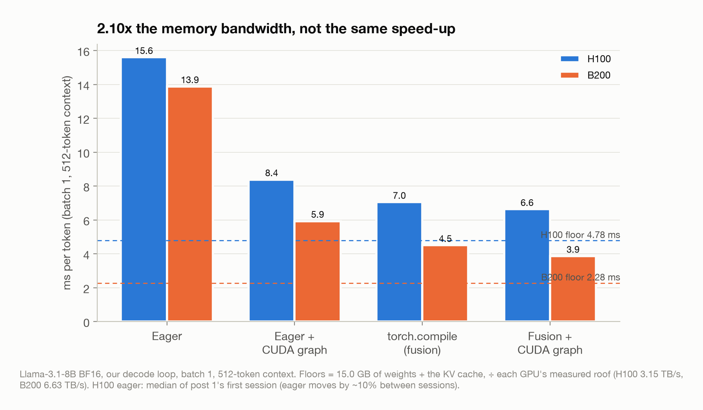

*The same decode step launched four ways on each GPU (batch 1, 512-token context). Dashed lines: each GPU's floor, the weights and KV cache read once at its measured roof. The B200 bars shrink less than the floors do.*

| Mode | H100 ms | B200 ms | Speed-up | B200 % of floor | B200 kernels per step |
|---|---|---|---|---|---|
| Eager | 14.5–16.4 | 13.88 | ~1.1× | 16% | 1,487 |
| Eager + CUDA graph | 8.38 | 5.93 | 1.41× | 38% | 1,487 |
| Fusion (torch.compile) | 7.05 | 4.50 | 1.57× | 51% | 556 |
| **Fusion + CUDA graph** | **6.63** | **3.86** | **1.72×** | **59%** | 557 |

(B200 timing: 3 runs per mode, each after a throwaway warm-up process; graphs repeat to within 0.1%. Eager varied 13.70–14.12 ms.)

**Eager is CPU-bound, as predicted.** The B200's GPU work per step is 6.1 ms of kernels in a 13.9 ms step; the rest is the GPU waiting for the CPU to launch the next kernel. A faster GPU doesn't help a program that can't feed it.

**The surprise: graphs + fusion reach only 59% of the floor (H100: 72%).** The measured bandwidth went up 2.10× (6.625 vs 3.154 TB/s), the best step only 1.72×. Where the time goes, from nsys (5 replays, same kernels as H100 apart from the GPU-specific matmul and attention kernels):

| Kernel group (per step) | H100 | B200 | Speed-up |
|---|---|---|---|
| Weight matmuls | 5.71 ms | 3.38 ms | 1.69× |
| Attention (512 tokens) | 0.34 ms | 0.34 ms | 1.0× |
| Norms, RoPE, elementwise | 0.20 ms | 0.29 ms | 0.7× |
| Sampling | 0.03 ms | 0.06 ms | 0.5× |

Per kernel (mean µs per call in one traced step; `RESULTS_B200.md`, "H100 vs B200, kernel by kernel"):

| Kernel | Bytes | H100 | B200 | Speed-up |
|---|---|---|---|---|
| `lm_head` matmul | 1.05 GB | 350 | 154 | 2.27× |
| MLP matmuls (gate, up, down) | 117 MB | 40.3 | 21.2 | 1.90× |
| K / V projections | 8 MB | 5.60 | 5.58 | 1.00× |
| Attention, 512 tokens | 3 MB | 6.8 | 8.7 | 0.78× |
| Split-K reduction | tiny | 1.6–1.8 | 2.6–2.8 | ~0.6× |

**What it means: every kernel pays a fixed cost of a few microseconds, and that cost doesn't shrink with bandwidth.** The 117 MB MLP matmuls take about 3 µs longer than their bytes need on *both* GPUs (40.3 vs 37.2 µs on H100, 21.2 vs 17.7 µs on B200): the time to start the kernel, fill the memory pipeline and drain it at the end. On the H100 that's 8% of the kernel; on the B200 it's 16%. Kernels that move only a few MB are almost entirely fixed cost, so they don't speed up at all. A decode step at batch 1 is 557 such kernels.

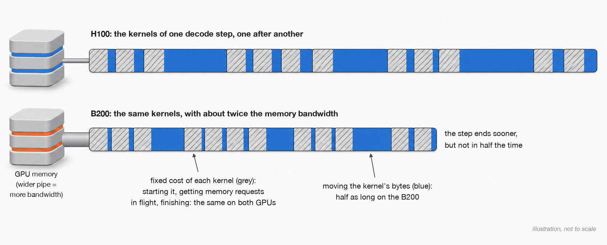

*The idea in one picture. A decode step is a long row of GPU kernels (557 at batch 1; 12 are drawn here). Each one pays a fixed cost to start, get its memory requests in flight and finish (grey), plus the time to move its bytes (blue). The B200's faster memory halves the blue parts but not the grey ones, so a step made mostly of small kernels gets well under 2× faster.*

The same thing in one number: the gap above the floor at 2k context is **1.89 ms on the H100 and 1.60 ms on the B200**. The floor halved; the overhead barely moved.

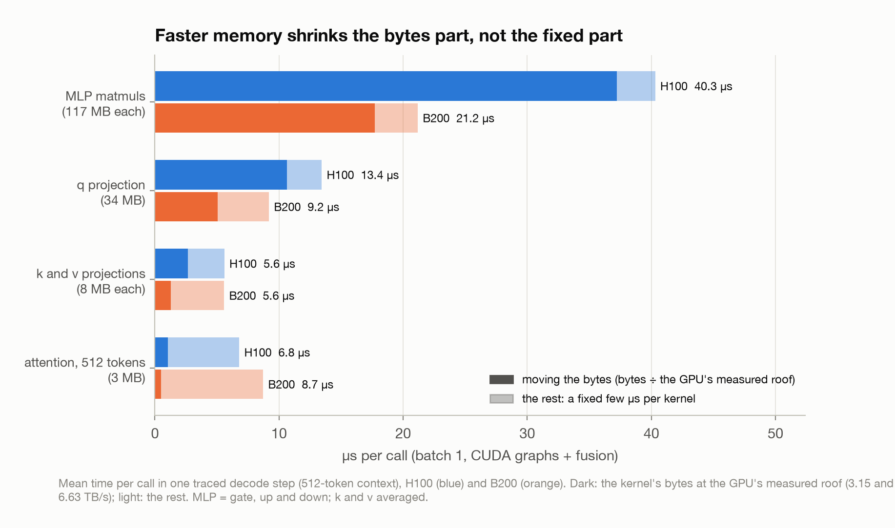

*Four kernels from the same traced step on both GPUs. The dark part of each bar is the kernel's bytes read at its GPU's measured roof; the light part is everything else. The dark parts halve on the B200; the light parts stay at a few µs or grow.*

**Measured directly.** The numbers above come from kernels inside a decode trace. To measure the fixed cost on its own, a second session timed batch-1 BF16 matmuls of 11 sizes from 0.5 MB to 1 GB, including every shape a decode step uses ([`bench/fixed_cost.py`](../bench/fixed_cost.py)). Each size runs hundreds of times back to back inside one CUDA graph, each call on its own copy of the weight (2 GiB of copies, far more than the 126.5 MiB L2), so every call reads HBM as in decode. The results (`RESULTS_B200.md`, "Fixed cost per kernel, measured directly"):

| Matmul | Weight MB | µs per kernel | TB/s | Above the roof |
|---|---|---|---|---|
| tiny (64 outputs) | 0.5 | 3.73 | 0.14 | 3.65 µs |
| k, v | 8.4 | 5.64 | 1.49 | 4.37 µs |
| q, o | 33.6 | 8.13 | 4.13 | 3.06 µs |
| gate, up | 117 | 19.64 | 5.98 | 1.92 µs |
| down | 117 | 22.70 | 5.17 | 4.97 µs |
| `lm_head` | 1,051 | 156.77 | 6.70 | −1.82 µs |

A matmul that reads almost nothing still takes **3.7 µs**, and the decode shapes sit 2–5 µs above their bytes at the roof. That's the fixed cost the trace comparison inferred, measured on its own. It isn't one fixed number per kernel: `down` reads the same 117 MB as gate and up but costs 3 µs more (in the decode trace cuBLAS runs `down` with split-K, which adds a reduction kernel; gate and up don't, and the sweep times the whole call), and `lm_head` comes out slightly *faster* than its bytes at the roof, probably because each call starts before the previous one ends. (Only the B200 was measured this way; the H100 VM had been deleted.)

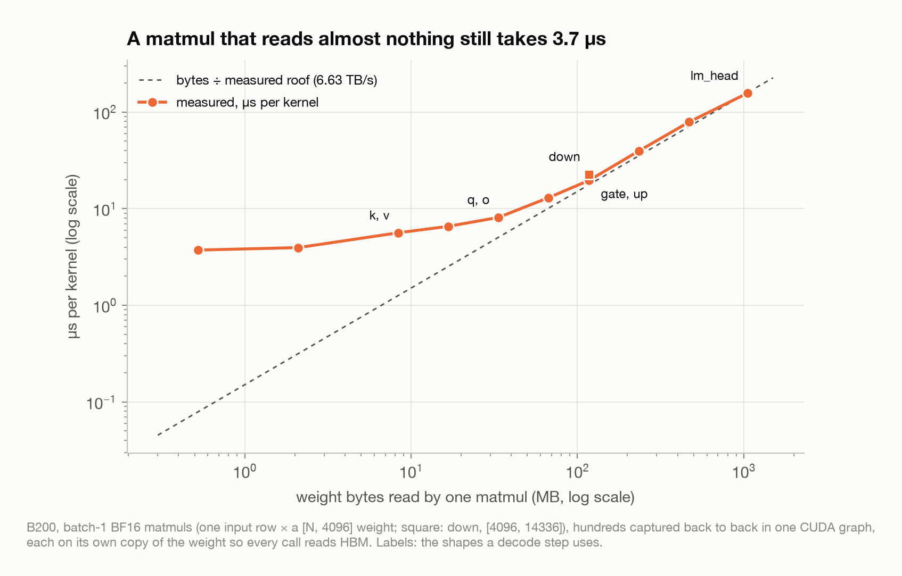

*Each point is one matmul size: the time per call when hundreds run back to back, against the weight bytes it reads (both axes logarithmic). The dashed line is bytes ÷ the measured roof. Big matmuls sit on it; below about 10 MB the time stays between 3.7 and 5.6 µs however few bytes are read. The k and v projections are in that flat part, and q and o are still mostly fixed cost.*

**A detail that changes how to read B200 traces.** On the B200, 74% of kernels start *before* the previous one finishes, by 0.65 µs on average: the next kernel is launched early and waits for its inputs (programmatic dependent launch, which the B200's cuBLAS kernels use). So the kernel durations add up to 4.18 ms, more than the 3.86 ms the step takes (`RESULTS_B200.md`, "Overlapping kernels" and the kernel breakdown's negative idle). Each B200 kernel time includes a little waiting; subtracting the overlap still leaves the MLP matmuls more than 2 µs above their bytes. In the H100's graphs + fusion trace no two kernels overlap.

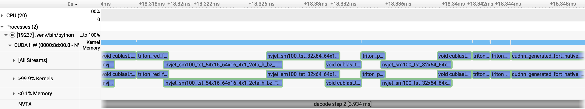

*About 33 µs of one B200 decode step in Nsight Systems. Nsight draws a kernel on a second row when it starts before the previous one has finished; here most of them do.*

## B2: batching

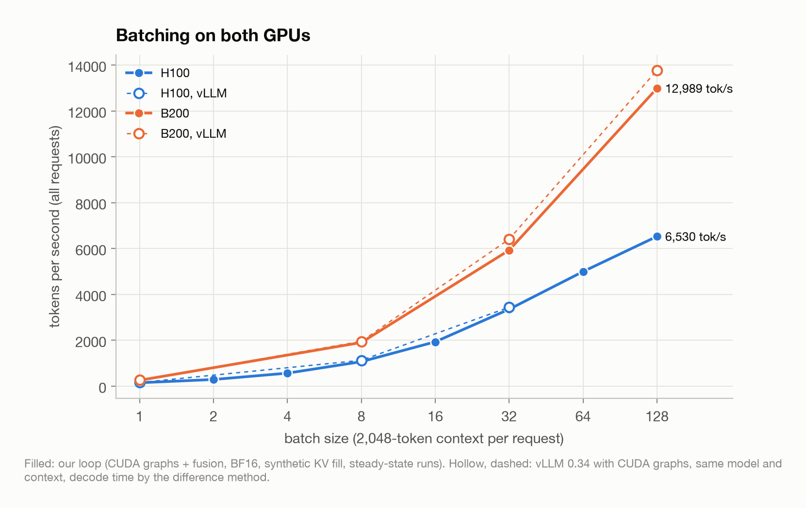

*Tokens per second over all requests, batch 1 to 128, each request with a 2,048-token context. The B200 pulls away as the batch grows: 1.73× at batch 1, 1.99× at batch 128. Hollow points: vLLM on each GPU (B5), a few percent faster than our loop on both.*

| Batch | H100 ms | B200 ms | B200 tok/s | B200 % of floor | Speed-up |
|---|---|---|---|---|---|
| 1 | 6.74 | 3.90 | 256 | 59% | 1.73× |
| 8 | 7.50 | 4.20 | 1,904 | 62% | 1.78× |
| 32 | 9.54 | 5.40 | 5,929 | 66% | 1.77× |
| 128 | 19.60 | 9.85 | **12,989** | **76%** | **1.99×** |

**What it means.** Bigger batches mean more bytes per kernel (more KV cache for attention to read), so the fixed per-kernel cost becomes a smaller share and the B200 gets close to its 2.10× bandwidth advantage. At batch 128 it's 2× the H100's throughput.

## B3: low precision on Blackwell

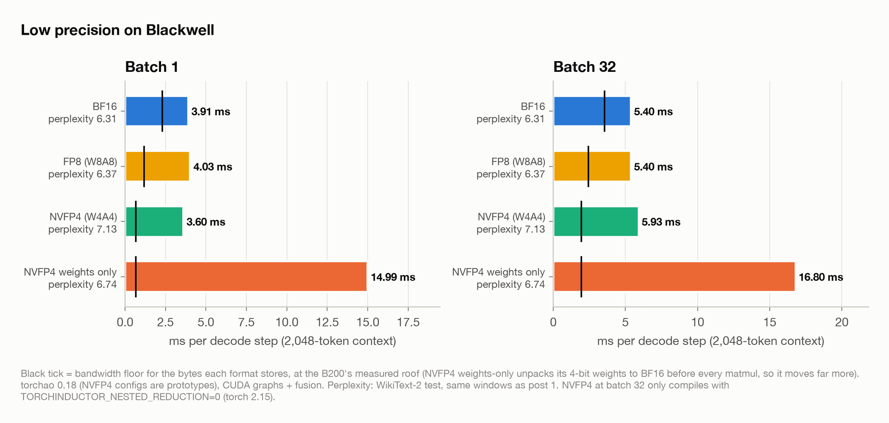

*Step time for four weight formats at batch 1 and batch 32 (2,048-token context), with each format's perplexity. Black tick: the bandwidth floor for the bytes each format stores. Only NVFP4 at batch 1 is meaningfully faster than BF16 (8%), and the fewer the bytes, the further the bar sits from its tick: at batch 1, BF16 takes 1.7× its floor, FP8 3.4× and NVFP4 5.3×.*

| Weights (2k context) | Bytes read per step | B=1 ms | B=32 ms | Perplexity |
|---|---|---|---|---|
| BF16 | 15.01 GB | 3.90 | 5.40 | 6.31 |
| FP8 (weights + activations) | 7.51 GB | 4.03 | 5.39 | 6.37 |
| NVFP4 (weights + activations, W4A4) | 4.22 GB | 3.60 | 5.93 | 7.13 |
| NVFP4 weights only | 4.22 GB | 14.99 | 16.80 | 6.74 |

(torchao 0.18; the NVFP4 configs are prototypes. Perplexity: WikiText-2 test, the same 141 windows and 288,627 tokens as post 1; BF16 6.3086 here vs 6.3095 on the H100.)

**What we predicted.** Fewer bytes, but well short of the byte ratio. It was much worse than that: **no low-precision scheme made batch-1 decode meaningfully faster**, and the weight-only one made it 4× slower. The traces say why, one scheme at a time:

- **FP8 (0.97×, slightly slower).** The FP8 matmuls read 7.5 GB in 2.68 ms per step: **2.8 TB/s, 42% of the roof** (BF16's matmuls manage 4.4 TB/s). The main reason is the one post 1 found for FP8 on the H100: too few thread blocks. PyTorch runs these matmuls with a CUTLASS kernel that gives each block 128 output columns (64 for k and v) and never splits the long input dimension, so five of the seven matmuls in each layer launch 16 or 32 blocks on 148 SMs: 16 for k and v, 32 for q, o and down. For the same layers, cuBLAS's BF16 kernels launch 64–128 blocks, partly by splitting the input dimension (split-K). Those five FP8 matmuls take about as long as in BF16 with half the bytes (down: 21.0 vs 24.4 µs per call; k and v read at 0.5 TB/s). Only the matmuls wide enough to fill the GPU anyway get faster: gate and up (112 blocks) and `lm_head` (1,002) stream FP8 at 4.3–5.1 TB/s (`RESULTS_B200.md`, "Weight matmuls by layer role"). Two smaller costs then tip the step from break-even to slightly slower. Every linear layer first quantizes its input activations to FP8: 0.49 ms per step in Triton kernels that also do the RMSNorms, which BF16 runs as separate small kernels in 0.29 ms. And the CUTLASS kernels don't use early launch: in the BF16 step 74% of kernels start before the previous one ends, and the kernel times add up to 0.32 ms *more* than the step; in the FP8 step none do, and the step is 0.36 ms longer than its kernels. Half the bytes, but five of the seven matmuls per layer read them at about half BF16's speed. Nsight Compute (second session, clocks unlocked) confirms the picture: the 16- and 32-block FP8 matmuls fill 0.11–0.22 waves of the GPU, and on the SMs that do have a block the tensor pipe is busy 57–77% of the time, mostly multiplying the padding of a 128-row tile (`RESULTS_B200.md`, "Nsight Compute with unlocked clocks").
- **NVFP4, W4A4 (1.08×).** The FP4 matmuls use Blackwell's block-scaled FP4 tensor cores (one E4M3 scale per 16 values), and their bytes do shrink: 4.2 GB. But they read them at **2.2 TB/s, 34% of the roof** (1.5 TB/s counting the kernels that quantize the activations; `RESULTS_B200.md`, "Weight-matmul bandwidth"). Nsight Compute shows why: the kernel uses 128-column tiles and launches one thread block per tile, so a 4096-wide output gets **32 thread blocks for 148 SMs** (0.22 waves) and the K/V projections get 8. Most of the chip sits idle, and the SMs that do work are busy with padded math: their tensor pipes are active about half the time (48% of active cycles), because our single row is padded to a full tile. These kernels are built for big batches. On top of that, quantizing the activations to FP4 adds small kernels around every matmul: 1,129 launches per step instead of 557, and the small-op time doubles (0.29 → 0.62 ms; the BF16 trace was taken at 512 tokens of context, the NVFP4 one at 2,048).

  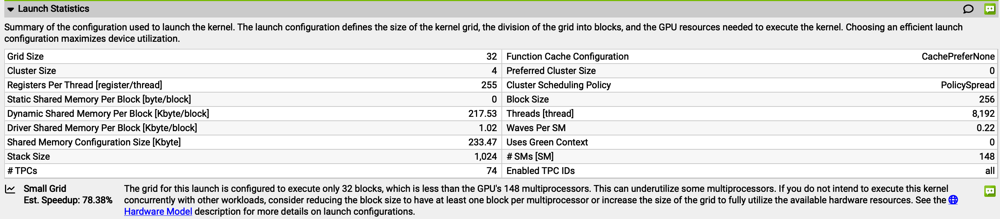

  *Nsight Compute's launch statistics for the FP4 matmul of a 4096-wide layer: a grid of 32 thread blocks on a GPU with 148 SMs (0.22 waves). Nsight raises the "Small Grid" warning on its own.*
- **NVFP4 at batch 32 (0.91×, slower than BF16).** Same matmul cost as batch 1 (2.53 ms), plus attention over 32 × 2k tokens of BF16 KV cache (1.73 ms) and 1.2 ms of activation-quantization and other small kernels.
- **NVFP4 weights only (0.26×).** torchao's weight-only path doesn't have a fused kernel here: it **dequantizes every weight back to BF16 in separate Triton kernels** (11.5 ms per step), writes the BF16 copy, and then runs the ordinary BF16 matmul on it (3.2 ms). It reads 4.2 GB, writes 15 GB and reads 15 GB again: more memory traffic than plain BF16, not less.

**What failed.** NVFP4 at batch 32 didn't compile at first: Inductor crashed in its memory-planning pass ("Cycle detected in memory planning graph"). Turning that pass off (`reorder_for_peak_memory`) only moved the crash (`KeyError: FusedNestedReductions`). Disabling the fusion it came from, `TORCHINDUCTOR_NESTED_REDUCTION=0`, worked; a BF16 control run with the same setting was unchanged (5.397 ms), so the setting itself doesn't affect timing.

**What it means.** Low precision only pays off if the kernels that read the smaller weights are as good at streaming memory as the BF16 ones. At batch 1 on this software stack they aren't: the FP8 and FP4 matmuls are tuned for the large-batch, compute-bound case (prefill, training), where their tensor cores matter. Post 1 found the same on the H100 (FP8 at 1.50 TB/s effective, also from launching 8–32 blocks). The quality cost is the same as on the H100: FP8 +1%, NVFP4 W4A4 +13% perplexity (H100 INT4: +12%).

## B4: long context

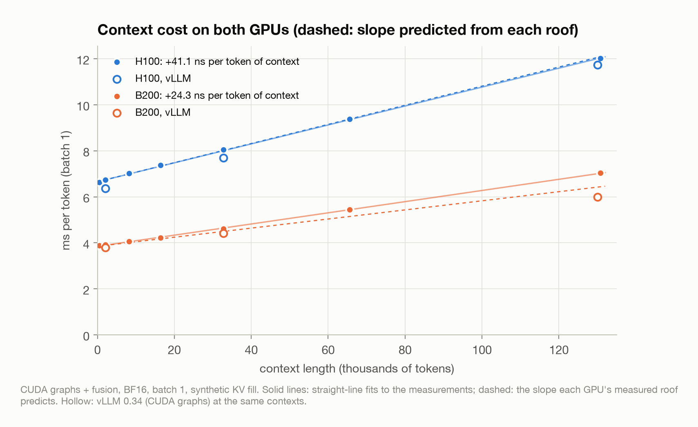

*Step time at batch 1 as the context grows. Filled points: our loop; solid lines: straight-line fits to them; dashed: the slope each GPU's measured roof predicts. The H100 sits on its prediction; the B200 grows faster than its own (24.3 vs 19.8 ns per token). Hollow points: vLLM (B5), whose B200 attention kernel copes much better at 128k.*

| Context | B200 ms | % of floor |
|---|---|---|
| 512 | 3.88 | 59% |
| 2k | 3.91 | 59% |
| 8k | 4.06 | 60% |
| 16k | 4.23 | 61% |
| 32k | 4.61 | 63% |
| 64k | 5.44 | 65% |
| ~128k | 7.03 | 69% |

A straight line through the seven points: **3.85 ms + 24.3 ns per token of context** (within 0.04 ms of every point; H100: 41.1 ns; `RESULTS_B200.md`, "Cost per token of context"). Each extra token of context adds 24.3 ns, so the attention kernel reads the KV cache at **5.4 TB/s, 82% of the roof**. On the H100 it read it at the full roof. Predicted: 19.8 ns per token at the measured roof. (The first session had only the 2k, 32k and 128k points, which gave 24.4 ns; the second session added 512, 8k, 16k and 64k.)

**Which attention kernel.** Both GPUs use cuDNN's flash-attention kernel, in different generations. On the H100 it's an Ampere-era kernel (`HMMA` tensor-core instructions, `LDGSTS` asynchronous copies). On the B200 it's a Blackwell-native one: `UTCHMMA` (the 5th-generation tensor-core instruction) with operands in Blackwell's new *tensor memory* (`LDTM`/`STTM` move data in and out) and TMA bulk loads. Newer, but at 4 FLOPs per byte the tensor cores don't matter; it streams the cache less efficiently than the old kernel did on the H100. One measured reason is the launch shape. At 64k context the H100's kernel runs 256 thread blocks (32 heads × 8 chunks of the sequence; post 1, E4), about two per SM on 132 SMs, so every SM is pulling from memory. The B200's kernel runs **72 blocks on 148 SMs (0.49 waves)** (`RESULTS_B200.md`, "Nsight Compute with unlocked clocks"): about half the SMs are idle, and the active ones can't keep enough reads in flight to saturate memory. Memory only delivers full bandwidth when a few MB of requests are outstanding at once, and each SM can only have so many. It's the small-grid problem of the FP4 matmuls (B3) in a milder form. (Not tested: whether each block's copy pipeline depth also matters.) vLLM's Blackwell attention kernels are named `...MultiCtasKv...`, i.e. they split each sequence's KV cache across several thread blocks, and they reach 81% of the floor at 128k (B5).

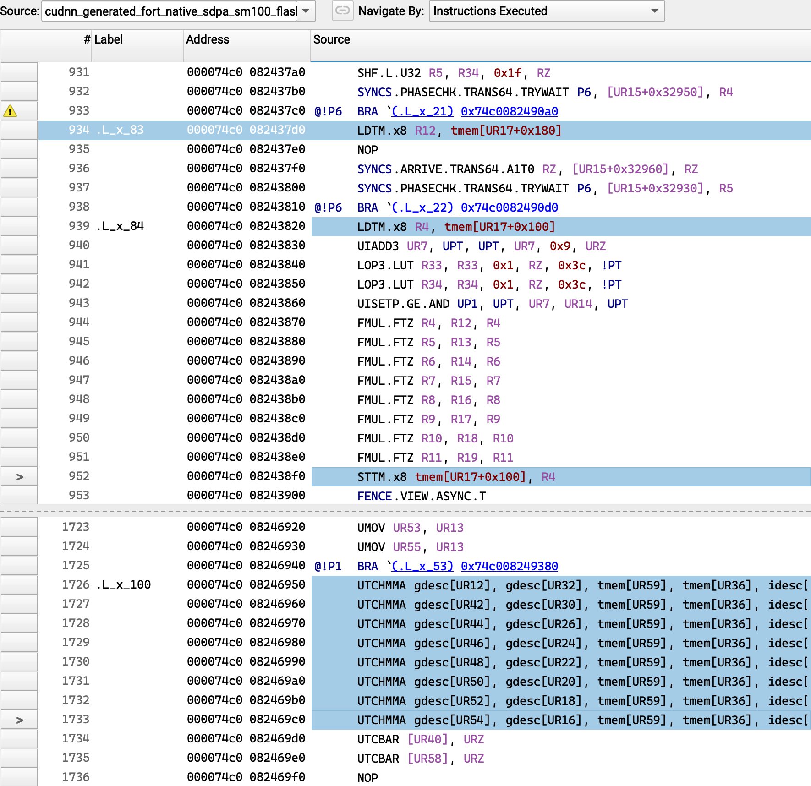

*The B200's attention kernel (64k context) in Nsight Compute's instruction view, two crops of the same kernel. Top: `LDTM` loads values from tensor memory into registers, `FMUL` multiplies them, `STTM` stores the results back. Bottom: a run of eight `UTCHMMA` tensor-core instructions.*

## B5: vLLM on the B200

**What and why.** Is the drop from 72% of the floor (H100) to 59% (B200) our loop's fault? vLLM, measured exactly as in post 1's E7 (same version, 0.34.0; time 257 generated tokens and 1, divide the difference by 256; [`decode/vllm_bench.py`](../decode/vllm_bench.py)), answers that. On Blackwell, vLLM runs attention through FlashInfer's TensorRT-LLM kernels, with the KV cache in BF16 as in our loop.

| | H100 vLLM | B200 vLLM | B200 our loop | vLLM ahead on B200 |
|---|---|---|---|---|
| B=1, 2k context | 6.37 ms (76% of floor) | **3.80 ms (61%)** | 3.90 ms (59%) | 2.8% |
| B=8 | 7.10 ms | 4.10 ms | 4.20 ms | 2.6% |
| B=32 | 9.30 ms | 4.99 ms | 5.40 ms | 8.1% |
| B=128 | – | **13,774 tok/s (80%)** | 12,989 tok/s (76%) | 6.0% |
| B=1, 32k context | 7.69 ms | 4.42 ms (66%) | 4.61 ms (63%) | 4.4% |
| B=1, ~128k context | 11.73 ms | **6.00 ms (81%)** | 7.03 ms (69%) | 17% |
| B=1, no CUDA graphs | 12.20 ms | 10.07 ms | – | – |

(`RESULTS_B200.md`, "B5" and the B2/B4 tables; `RESULTS.md`, "E7". H100 vLLM at 2k was run at B=1, 8 and 32 only. Our 128k point is 130,794 tokens, vLLM's 130,000.)

**What it means.**
- **At short context, vLLM hits the same wall.** It goes from 76% of the floor on the H100 to 61% on the B200, a 1.68× speed-up for 2.10× the bandwidth, just like our loop (1.73×). The fixed cost per kernel isn't something our ~300 lines added; a production engine pays it too. vLLM stays a few percent ahead on both GPUs, as in post 1.
- **At long context, vLLM's attention kernel is much better on Blackwell.** At ~128k it reaches 81% of the floor against our 69%, and it's 17% faster. That's the attention kernel (FlashInfer's TensorRT-LLM kernels vs cuDNN's in our loop), since nothing else in the step depends on context. So B4's "KV cache at 82% of the roof" is a property of the cuDNN kernel, not of the B200.
- **vLLM's step doesn't grow along a straight line.** From 2k to 32k it adds 20.1 ns per token (right at the roof's 19.8); from 32k to 128k only 16.3 ns, which would mean reading the BF16 KV cache faster than the roof. It can't, so something at 32k is less efficient than at 128k (likely a different kernel configuration for that length; not traced). The total at 128k, 81% of the floor, is consistent with the bytes. That's why the table compares % of floor, not slopes.
- **Without CUDA graphs** vLLM takes 10.1 ms on the B200 (12.2 ms on the H100), 2.7× slower than with graphs: launch overhead again.

## Instructions: what Blackwell runs (SASS)

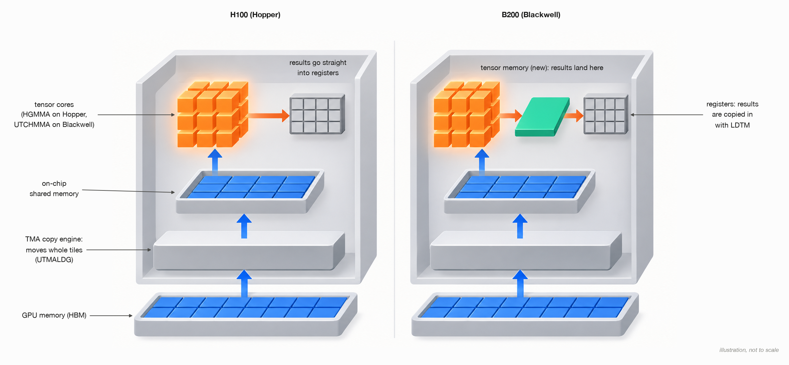

*Where the tensor cores' results go. On both GPUs the TMA copy engine moves whole tiles from GPU memory into on-chip shared memory, which feeds the tensor cores. On the H100 the results land directly in registers. On the B200 they land in tensor memory, a new on-chip store next to the tensor cores, and `LDTM` copies them into registers: that's the `LDTM` in the instruction listings below.*

From Nsight Compute's source view ([`analysis/sass_mix.py`](../analysis/sass_mix.py)):

| Kernel | H100 | B200 |
|---|---|---|
| BF16 weight matmul | `HGMMA` + `UTMALDG` (TMA) | `UTCHMMA` + `UTMALDG`, results out of tensor memory with `LDTM` |
| FP4 weight matmul | (no FP4 tensor cores) | `UTCOMMA`, scales copied into tensor memory with `UTCCP` |
| Attention | `HMMA` + `LDGSTS` | `UTCHMMA` + `LDTM`/`STTM` + `UTMALDG` |

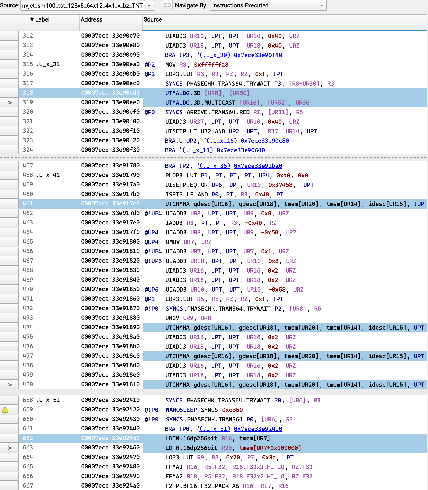

*The B200's MLP gate matmul, three crops of the same kernel. Top: `UTMALDG` loads tiles of weights and inputs with TMA. Middle: `UTCHMMA` multiplies them into tensor memory. Bottom: `LDTM` reads the results out of tensor memory, and `FFMA2`/`F2FP` finish them and convert them to BF16.*

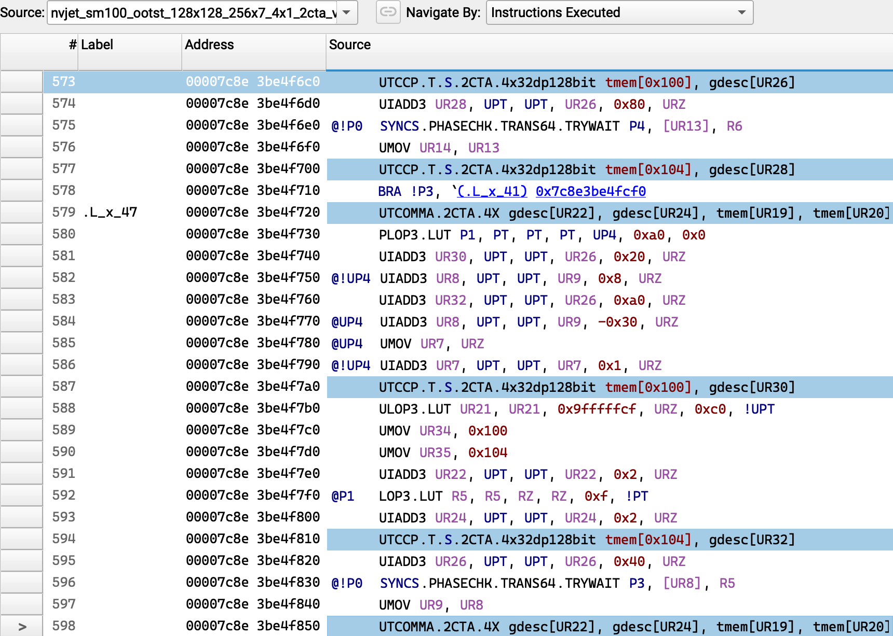

*The FP4 matmul: `UTCCP` copies the block scales into tensor memory, and `UTCOMMA` multiplies the 4-bit values, with two thread blocks sharing one tile (`2CTA`).*

At batch 1 none of this decides the speed: averaged over the whole GPU, the tensor pipes are under 8% busy in every matmul. (The FP4 matmul is busier on the few SMs it uses, see B3.) But it shows that the B200's libraries are fully on the new tensor-core path.

## What we learned (post 2 in one paragraph)

The bandwidth model still predicts the *floor* exactly, and decode is still memory-bound on Blackwell. But the faster the memory, the more everything that isn't bandwidth shows: a fixed few-microsecond cost per kernel (B200 batch 1: 59% of the floor vs 72% on the H100), an attention kernel (cuDNN's) that streams the KV cache at 82% of the roof, and low-precision matmuls built for big batches that read their smaller weights at 34–42% of the roof. Moving fewer bytes only helps if the kernel can still move them fast. Batching (76% at B=128) and long context (69% at 128k) hide the fixed costs, and that's where the B200 delivers its 2×. vLLM shows the same wall at batch 1 (61% of the floor), so it isn't our loop; it does better at long context (81% at 128k) with a better attention kernel.

## Caveats

- Nsight Compute locks clocks to base by default. In the first session its "% of peak DRAM" numbers came out far below the timing runs (gate/up 63%, attention at 64k 49%), so those reports are used only for instruction mix and launch geometry. The second session re-profiled the key kernels with `--clock-control none` (`RESULTS_B200.md`, "Nsight Compute with unlocked clocks"): `lm_head` 98% of the roof, gate/up ~80%, attention at 64k 70%. Nsight Compute still replays each kernel alone with cold caches, so small kernels look slower there than inside a step.
- The first session's `reports/B_lm_head` captured the wrong kernel (an elementwise kernel inside the `lm_head` NVTX range); the second session recaptured it (`B_lm_head_free`).
- One B200 VM, two sessions (the second was preempted once after 2 minutes and resumed). Graph modes have 3 runs per configuration and repeat to within 0.5% in BF16 and 1.3% in the quantized formats; eager varied 13.70–14.12 ms (H100 varied up to 5%).
- The fixed-cost sweep was run on the B200 only.
- NVFP4 and FP8 numbers are for torchao 0.18 + torch 2.15 kernels; better small-batch FP4 kernels (e.g. in TensorRT-LLM) may change the B3 picture. That's a library result, not a hardware limit.
